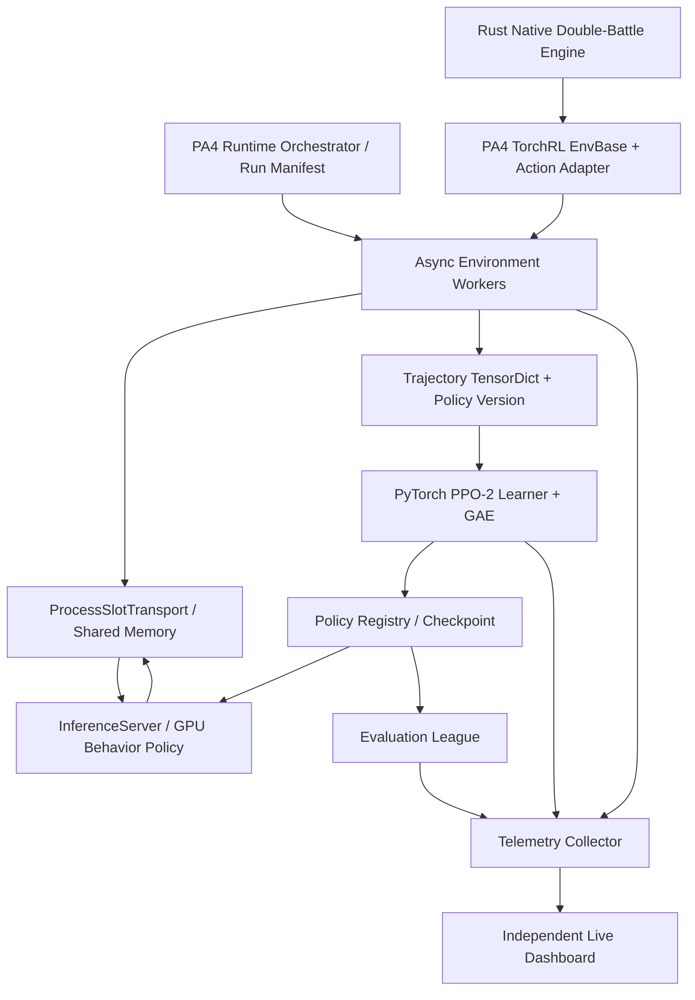
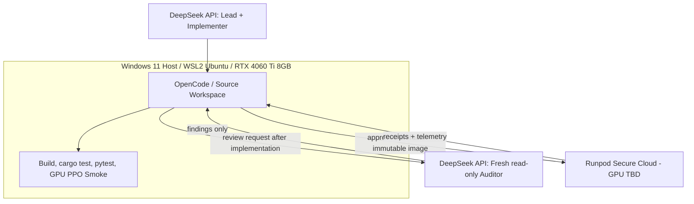

# PokeAgent 4.0 — Master Architecture & Phased Implementation Plan

**Document ID:** `PA4-MASTER-ARCH-v1.2`  
**최초 작성:** 2026-10-20 (KST)  
**최종 개정:** 2026-10-21 (KST)  
**상태:** 구현 착수 전, Windows/WSL2 및 DeepSeek-only 에이전틱 개발 계약 동결  
**대상:** PokeAgent4.0, Pokémon Champions Regulation M-C VGC Doubles  
**개발 워크스테이션:** Windows 11 호스트 + WSL2 Ubuntu 24.04 + RTX 4060 Ti 8GB  
**코딩 하네스:** OpenCode (WSL2에서 실행)  
**LLM:** DeepSeek V4.1-Flash-1017 API (`deepseek-flash`) 단일 제공자. 구현과 리뷰는 서로 다른 컨텍스트에서 수행  
**정식 학습 환경:** 추후 선정할 Runpod Secure Cloud GPU (현재 모델 미확정)  
**선정 프레임워크:** TorchRL/TensorDict. TorchRL 0.14 문서는 기능 참고이며 P0에서 설치 가능한 호환 버전과 모든 의존성을 고정한다.  
**프로젝트 원칙:** PA4는 별도 작업공간에서 개발하고 PokeAgent3.0의 정식 학습, 체크포인트, 기존 브랜치를 변경하지 않는다.

> **한 문장 요약:** 기존 Rust 배틀 의미론을 재사용한 TorchRL 기반 고속 PPO 시스템을 Windows 11 + WSL2 + RTX 4060 Ti 8GB에서 개발한다. 모든 PA4 코딩과 검토는 DeepSeek API로 수행하되 구현과 읽기 전용 검토 컨텍스트를 분리하고, 객관적 판정은 자동 테스트로 내린다. 생산 GPU는 Runpod 실측으로 선정한다.

### v1.2 변경 이력 (v1.1 대비)

| 변경 항목 | v1.1 | v1.2 결정 |
|---|---|---|
| 개발용 컴퓨터/GPU | Windows 11 + WSL2, RTX 4060 Ti 8GB | **변경 없음** |
| RL 스택, 게임 규칙, 성능 목표 | Rust + TorchRL + PPO-2, 1,000 matches/s 목표 | **변경 없음** |
| 코딩 모델 | DeepSeek Lead + MiniDC Qwen Implementer | **DeepSeek 단독 구현** |
| 검토 | 다른 컨텍스트 DeepSeek Auditor | **DeepSeek 별도 읽기 전용 컨텍스트**, 동일 모델이라는 한계 명시 |
| OpenCode | 복수 모델/서브에이전트 라우팅 | **`pa4-lead` (primary) + `pa4-auditor` (subagent)** |
| MiniDC | Qwen API 제공 | **PA4 개발에서는 사용하지 않음**. 기존 전역 MiniDC 설정은 훼손하지 않음 |
| P0 G0-C | DeepSeek → Qwen 위임 + DeepSeek Auditor | **DeepSeek 직접 도구 호출 + 새 컨텍스트 Reviewer 무수정 확인** |

> **문서 정합성:** 사용자가 제공한 마스터 v1.0은 원래 하드웨어 계획의 이전 기준, 2026-10-21 v1.1은 Windows 개발 환경을 이미 반영한 직접 개정 기반이다. 본 v1.2는 v1.1의 기술 아키텍처와 P0~P9 번호를 보존하며 에이전트 역할만 일원화한다. 관련 P0 정본은 `PA4-P0-DESIGN-v1.1`이다.

---

## 0. 결정사항과 아직 결정하지 않은 사항

### 0.1 지금 결정한다

1. **프레임워크:** TorchRL을 PA4의 주력 수집 및 PPO 구성요소로 채택한다. `EnvBase`, `TensorDict`, `AsyncBatchedCollector`, `InferenceServer`, `ProcessSlotTransport`, GAE 등을 활용한다. 반드시 모든 컴포넌트를 사용할 필요는 없다.
2. **게임 규칙:** Rust 엔진이 정본이다. 쇼다운 기반 의미론, 동시 행동, RNG, 정보 비공개, 합법 후보 및 자연 종료 판정은 재작성하지 않는다.
3. **초기 정책:** PA3의 기존 PyTorch 정책을 **정확성 기준**으로 연결한다. 모델 경량화는 후속 독립 연구로 분리한다.
4. **알고리즘:** 처음에는 동기식 On-policy PPO-2로 올바른 실행을 증명한다. 비동기는 정책 버전 및 학습 품질 검증 이후에 활성화한다.
5. **플랫폼:** 개발, 빌드, 정확성 검증, 소규모 PPO는 Windows 11의 WSL2 Ubuntu 24.04와 RTX 4060 Ti 8GB에서 수행한다. MiniDC는 PA4 코딩 및 학습 작업에 사용하지 않는다. 최신 GPU 호환성 점검과 하드웨어별 성능 튜닝은 Runpod Secure Cloud에서 수행한다.
6. **성능 목표:** 실제로 완료되어 PPO 학습에 채택된 자연 배틀 기준 **지속 1,000 matches/s 이상**. 이 수치는 목표이지 보장된 속도가 아니다.
7. **개발 방식:** 마스터 설계서 → 각 Phase 상세 설계서 → OpenCode 실행 프롬프트 → DeepSeek 직접 설계/구현 → 자동 테스트 → 새 컨텍스트의 DeepSeek 읽기 전용 리뷰 → 증거 기반 Gate 승인.

8. **작업 동시성:** 하나의 쓰기 담당 DeepSeek 세션만 작업공간을 수정한다. 검토용 DeepSeek 세션은 작업 내용을 읽기만 한다. 멀티 에이전트 Swarm, 병렬 파일 편집, 자체 Orchestrator 제작은 기본적으로 금지한다.
9. **8GB 개발 프로파일:** 소규모 배틀/학습의 의미론적 정확성을 목표로 한다. 4060 Ti에서 1,000 matches/s, 대형 배치, 멀티 GPU 성능을 입증하려 하지 않는다.

### 0.2 지금 결정하지 않는다

- 최종 GPU 모델, GPU 개수, CPU/RAM 프로파일 및 데이터센터
- 개발 PC의 WSL2에서 DeepSeek API 인증/라우팅을 사용할 수 있는지 여부 (P0에서 실제 확인)
- OpenCode 및 DeepSeek API의 실행 시점 버전 및 요청별 동작 옵션 (P0에서 고정)
- 최종 정책의 레이어 수와 파라미터 크기
- TF32/BF16 또는 CUDA Graphs 기본 활성화 여부
- 완전한 합법 Joint Action 사전 열거 방식 도입 여부
- 장기 비동기 학습의 `max_policy_lag`, PPO epoch 및 경험 혼합비
- 최종 1,000 matches/s 달성 경로. 실험 없이 특정 배수를 약속하지 않는다.

### 0.3 변경 통제

`PA4-MASTER-ARCH`의 핵심 목표와 불변 조건을 변경할 때는 별도 ADR(Architecture Decision Record)을 작성한다. 각 Phase 구현자는 설계에 없는 알고리즘 변경을 독단적으로 포함할 수 없다. 핵심 가정이 틀리면 해당 Gate를 `BLOCKED`로 처리하고 ADR을 제안한다.

---

## 1. 문제 정의와 성공 판정

### 1.1 공식 목표

- Regulation M-C 더블배틀의 자연 완료 게임을 정확하게 실행한다.
- 양측 Current-vs-Current Self-play에서 정당한 정책 행을 수집하고 PPO로 학습한다.
- 학습에 채택된 게임 기준 평균 `1,000 matches/s`를 장기 지속한다.
- 정확성, 정책 품질, 체크포인트 복원, GPU 비용을 별도 축으로 기록한다.
- Runpod 임시 중단이나 GPU 교체가 학습 정본을 손상시키지 않는다.

### 1.2 무엇을 1매치로 셀 것인가

**Completed natural match**: 규칙상 정당하게 종료된 하나의 배틀. 양측 각각의 정책 관측 행은 별도 행으로 기록하되 **하나의 배틀을 두 번 세지 않는다**. 오류 종료, 임의 타임아웃, 잘못된 행동, synthetic terminal, 학습 중단으로 버린 경기는 성공 매치에 포함하지 않는다.

측정값을 구분한다.

| 지표 | 의미 |
|---|---|
| `raw_completed_matches_per_sec` | 정상 완료한 전체 배틀 / 전체 wall time |
| `accepted_training_matches_per_sec` | 실제로 학습 데이터에 포함된 정상 완료 배틀 / 전체 wall time |
| `generated_policy_rows_per_sec` | 두 좌석의 정책 요청 등에서 생성된 유효 학습 행 / wall time |
| `learner_row_passes_per_sec` | PPO epoch 반복을 반영한 실제 학습 행 처리량 / wall time |
| `policy_updates_per_sec` | 성공적으로 완료된 Optimizer Step / wall time |
| `stale_drop_fraction` | 정책 지연 등으로 버린 행의 비율 |
| `target_strength_cost` | 미리 지정한 실력 기준에 도달하기 위한 총 비용 |

최종 성능 판정의 1,000/s는 `accepted_training_matches_per_sec`를 사용한다. 이 값은 수집, PPO 업데이트, 검증 및 필수 체크포인트 비용을 포함한 **벽시계 시간**에 근거한다. 비동기 모드에서는 폐기된 데이터와 학습기에 아직 소비되지 않은 큐를 완료로 세지 않는다.

### 1.3 과거 실측 기준과 해석 한계

- PA3 2026-10-11 프로파일: **43.477 자연 배틀/s**, V100 32GB ×2, 당시 8.76M 모델, PPO-4, steady 기준. 수집 12.53초(26.6%), GAE/준비 4.47초(9.5%), PPO 약 29초(61.1%).
- 동일 수집 구간: Python 행 저장/복사 약 4.46초, Rust 관측 인코딩 1.87초, 후보 Tensor 생성 1.35초, **순수 Rust 배틀 Step 0.19초**.
- PA3 V2 정본 문서(10월 16일 기준)는 약 **9.89M 파라미터**, PPO-2, 96개 토큰, 조건부 행동, 정책 인코더 FP32, 글로벌 미니배치 4,096, 양좌석 셀프플레이를 기록한다.
- 위 두 문서는 시점과 계약이 다르다. PA4에서 이를 동일한 실험인 것처럼 섞지 않는다. 최근 생산 체크포인트와 활성 프로파일은 **실제 운영 머신에서 재확인**해야 한다.

### 1.4 1,000/s에서 요구되는 계산량

이전 실측의 약 26.3 유효 정책 행/매치를 단순 적용하면:

- 1,000 match/s → 초당 **약 26,300개의 유효 정책 행** 생성
- PPO 2 epochs → 초당 **약 52,600 row-passes** 학습 처리 필요

이는 참고 산술값이다. 모델 크기, 실제 팀 구성, 경기 길이, 양측 데이터 활용 방식, PPO 배치/학습 정책이 변경되면 다시 계산한다. Actor 1,300~1,500 matches/s, Learner 70,000+ row-passes/s는 **목표 여유 용량**이지 이미 확인된 성능이 아니다.

### 1.5 성공 등급

- **Correctness Gate:** 규칙/확률/학습 계약이 맞고 완전한 복원 테스트를 통과했다.
- **Baseline Gate:** 기존 약 40/s와 정당하게 비교 가능한 full-stack 속도를 확보했다.
- **Acceleration Gate:** 지속 100/s 및 300/s 도달 여부를 실측 기록했다. 미달은 개선 과제를 의미한다.
- **Stretch Gate:** 지속 1,000/s 이상을 달성하고 실제 평가 성능도 개선한다.

1,000/s에 못 미쳐도 개발 결과가 유용할 수 있다. 다만 CPU/GPU 비용, 개발 난이도, 정책 실력이 현행 PA3보다 낫다는 증거를 제시해야 실제 4.0으로 승격한다.

---

## 2. 시스템 아키텍처



> 그림은 논리적 흐름이다. TorchRL Collector가 `AsyncEnvPool`, InferenceServer, 전환 배치 생성을 직접 오케스트레이션하는 실제 API 구성은 P0에서 고정한다. GPU Inference와 Learner가 하나의 GPU를 공유할지, 별도 GPU를 사용할지는 P7 성능 결과로 결정한다.

### 2.0A 개발 제어면과 학습 데이터면의 분리

PA4는 **개발 제어면(Control Plane)** 과 **학습 실행면(Data Plane)** 을 분리한다. 두 실행면의 GPU 메모리나 실행 책임을 혼동하면 안 된다.



- **Windows PC:** 모든 PA4 파일 편집, Git, 테스트, Rust 컴파일, PyTorch/TorchRL/RTX 4060 Ti 기능 검증의 실행 위치.
- **WSL2 Ubuntu:** Linux 멀티프로세싱/Shared Memory/CUDA 동작의 표준 개발 런타임. 프로젝트 소스는 WSL2의 Linux 파일시스템에 둔다. 필요 시 Docker Engine/WSL 통합을 활용한다.
- **MiniDC:** PA4 개발 및 학습에는 사용하지 않는다. 기존 MiniDC LLM 서비스와 전역 OpenCode 모델 설정은 본 프로젝트 변경 범위 밖이다.
- **DeepSeek:** 하나의 API 제공자로 전체 설계/구현/리뷰를 수행한다. 작성 세션과 읽기 전용 리뷰 세션을 분리하지만 두 세션은 같은 모델이므로 모델 간 독립 검증으로 간주하지 않는다. 출력의 정당성은 자동 테스트/계측으로 검증한다.
- **Runpod:** C1의 일회성 호환성 검증 및 P7 이후 실측/정식 학습용. 개발 시점에 최종 GPU를 고정하지 않는다.

#### 개발용 8GB GPU와 정식 GPU의 역할 경계

| 검증 가능 항목 | 4060 Ti 8GB / WSL2 | Runpod 필수 |
|---|---|---|
| Rust 규칙, action legality, logprob parity | 예 | 아니오 |
| EnvBase, TensorDict, Shared Memory API | 예 | 아니오 |
| Forward/Backward, 소규모 PPO-2, checkpoint 복원 | 예 (microbatch/환경 수를 낮춤) | 아니오 |
| Collector/inference 동시 실행, 정책 버전 추적 | 제한된 규모에서 예 | 운영 규모 검증은 예 |
| 수십 GB급 학습 Batch, 다중 GPU 분산 | 아니오 | 예 |
| 최종 `matches/s`, 클라우드 비용 대비 속도, 실전 CPU 병목 | 참고치만 가능 | **예** |

**8GB 개발용 최소 프로파일 시작 후보:** `envs=4~16`, `inference_batch=8~32`, `ppo_microbatch=16~64`, `epochs=2`, `precision=fp32_reference`, `compile=false`, `cuda_graphs=false`, `ddp=false`. 이는 동작 보장값이 아니다. 모델, 옵티마이저 및 버퍼의 실측 VRAM이 8GB를 넘으면 줄이고, 그래도 안 되면 CPU reference 또는 개발 전용 작은 배치 경로를 사용한다. 테스트를 통과시키려고 PPO 계약이나 합법 행동 의미론을 바꾸지 않는다.

**중요:** GPU Actor와 Learner의 동시 실행이 8GB에서 메모리를 초과하면 개발 모드에서는 동기식 수집 → PPO 업데이트를 우선 사용한다. P6에서 비동기 기능을 테스트하되 큰 규모의 중첩 처리량은 Runpod에서 평가한다. 4060 Ti의 Ada 아키텍처는 CUDA 개발에 유리하지만 Linux/WSL 드라이버, PyTorch 및 TorchRL 버전은 별도로 검증해야 한다.

### 2.1 구성별 역할 및 소유권

| 모듈 | 소유 역할 | 외부 인터페이스 |
|---|---|---|
| `engine` | 게임 상태/룰/RNG/합법성/자연 종료의 유일한 정본 | 기존 Rust/PyO3 Batch API |
| `env_adapter` | TorchRL EnvBase 명세, 양측 요청, reset/step/done/reward | TensorDict + ActionContract |
| `action_adapter` | 조건부 합법 행동의 정확한 완성, old/new logprob 재현 | RequestBundle ↔ JointAction |
| `collector` | 다중 환경 수집, 서버 요청, Shared Memory, 버퍼링 | P0에서 고정한 TorchRL collector API 계약 |
| `policy` | Actor, Critic 및 합법 행동 분포 | PyTorch/TensorDictModule 또는 동등한 모듈 |
| `learner` | PPO-2, GAE, 유효 행 정규화, 업데이트/수치 검증 | Versioned TrajectoryBatch |
| `selfplay` | 좌석/정책 배정, 대전 상대 풀, 정책 발행 | MatchAssignment + PolicyRegistry |
| `evaluation` | 학습과 격리된 실력 측정, 승격 기준 | Snapshot + ResultReceipt |
| `runtime` | 학습 실행, 장비 프로파일, 안전 중단 및 복원 | RunManifest + Checkpoint |
| `telemetry` | 성능/정확성/비용 이벤트 수집 | Versioned HTTPS Push Events |

### 2.2 하드웨어 비종속성과 하드웨어 종속성 분리

- **비종속:** 게임 의미론, 관측/행동/보상 스키마, PPO 손실, 평가, 체크포인트 논리, 텔레메트리 이벤트.
- **종속:** CPU worker 수, inference batch, pinned memory, microbatch, compiler backend, TF32/BF16, CUDA Graphs, GPU 분리/공유, GPU 메모리 한도.
- **원칙:** GPU 변경이 PPO 알고리즘 수정이나 행동 표현 변경을 요구하지 않도록 한다. 성능상 모델 교체가 필요하다면 신규 모델 스키마와 실험 ID를 발행한다.
- **개발/운영 프로파일 분리:** `dev_8gb`, `cloud_smoke`, `cloud_baseline`, `cloud_optimized`를 별도 버전 설정으로 보존한다. `dev_8gb`는 small-batch correctness, `cloud_optimized`는 full-stack throughput을 최적화한다.
- **이식 원칙:** Linux x86_64, 빌드/환경 lockfile, 모델 계약 및 체크포인트 포맷을 공통으로 유지한다. CPU 코어 수, VRAM 및 장치 기능은 런타임에서 확인하고 우발적인 기기 고정 코드를 금지한다.

---

## 3. 절대 깨지면 안 되는 불변 조건

### 3.1 게임 정확성

1. Rust 게임 규칙과 Showdown/Champions 대상 계약은 재작성하지 않는다.
2. 동시 행동, 기술 우선순위, 목표 선택, 교체/중복 제한, Mega 같은 공동 자원, 각종 상태 효과, RNG 결과를 보존한다.
3. 가려진 상대 정보는 Actor 관측과 학습 데이터에 유출하지 않는다.
4. 엔진이 허용하지 않은 행동은 분포상 확률 0이며 절대로 실행되지 않는다.
5. 운영 오류와 잘못된 자연 완료는 게임 수에서 제외한다. 예외를 조용히 승패로 변환하지 않는다.

### 3.2 조건부 행동의 최우선 계약

- 한 플레이어의 요청은 여러 선택 단계로 구성될 수 있으며, 뒤쪽 후보는 앞선 선택에 의해 바뀐다.
- `JointAction`은 **완성된 단일 플레이어 요청**을 뜻한다. 양측 플레이어의 동시 행동은 해당 두 요청을 엔진의 적절한 경계에서 조합한다.
- 기본 확률은 선택된 조건부 분포의 곱이며, `joint_log_prob = Σ valid_branch_log_prob`를 계산한다.
- 분기별 Entropy, `log K` 정규화, Uniform reverse-KL, Actor/Value mask의 기존 계약을 유지하거나 의도적 변경 시 별도 ADR로 정의한다.
- 저장된 Behavior Logprob는 **동일 정책 버전, 동일 관측과 합법 후보**를 사용해 재계산할 수 있어야 한다.
- 무제한 Joint-Action 사전 열거는 금지한다. 먼저 안전한 최대 크기와 실제 분포를 측정한다. 메모리 제한으로 합법 행동을 묵시적으로 잘라내면 안 된다.

**P1에서 결정할 두 경로:**

- **A (선호):** Rust가 유효한 조건부 후보 그래프 또는 크기 제한이 입증된 전체 합법 행동 집합을 배치로 제공하고, 중앙 GPU 정책 요청 **한 번**으로 완성 행동과 logprob를 계산한다.
- **B (정확성 우선 대안):** 기존 prefix-by-prefix 단계별 후보 질의를 유지하되 요청/응답을 배치로 전달하고, Encoder 계산은 동일 요청당 1회만 수행한다.

A가 안전하게 가능하다는 증거 없이 B를 제거하지 않는다. 이 문제가 `AsyncBatchedCollector`의 핵심 경로와 충돌한다면 P1에서 `BLOCKED`를 내고 TorchRL의 Collector 일부만 커스터마이징하는 ADR을 제안한다. PPO 계약을 바꿔 문제를 숨기지 않는다.

### 3.3 PPO 정확성

- 초기 알고리즘: 동기식 PPO-2, 클립 목적 함수, 학습 대상 Actor 행과 Value 행의 올바른 마스킹.
- 양좌석 Current-vs-Current에서는 **두 좌석의 유효 행**을 수집하되 한 매치는 한 번만 계수한다.
- 과거 체크포인트가 상대역인 경우 과거 상대 행을 현행 On-policy 학습 행으로 섞지 않는다.
- Value targets, GAE, `done/terminated/truncated` 및 Bootstrap 처리를 게임/플레이어/에피소드 경계마다 검증한다.
- PPO 확률, KL, Entropy, Loss는 기본 FP32. 혼합정밀 및 학습률/배치 변경은 별도 검증이 있을 때만 승격한다.
- `ClipPPOLoss`나 TorchRL GAE가 PA3의 수학을 그대로 재현한다고 가정하지 않는다. Golden Reference와 비교하며 필요한 항목은 Custom Loss로 보존한다.
- Async PPO는 학습의 다른 버전이다. `policy_version`, max lag, stale discard, importance ratio, 유효 데이터량을 추적하고 품질 테스트 후 활성화한다.

### 3.4 운영 정확성

- 전체 체크포인트에 모델, Optimizer, Scheduler, RNG, 데이터 집합/관측 계약 해시, 프레임워크/드라이버 환경, 글로벌 게임 카운터, 정책 버전 및 필요하다면 수집 파이프라인 복원 정보 포함.
- 저장은 임시 파일 → fsync/검증 → 원자적 승격 → 외부 백업을 기본으로 한다.
- 단일 기록원장(ledger)으로 자연 완료 매치를 정확히 한 번 커밋한다.
- Mid-iteration 안전 중단은 데이터 버퍼 폐기 또는 복구 방침이 명확해야 한다. 과장된 완전 재현성 주장은 금지한다.

---

## 4. 버전별 데이터 계약 (초안)

### 4.1 `PA4ObservationV1`

- PA3의 96 token 슬롯, 유형별 정수/연속 피처, 실제 관측 Mask 및 미공개 정보 규칙을 유지한다.
- 고정 크기 텐서/명시적 길이의 ragged 텐서를 선호한다. dtype, byte layout, padding 의미를 정의한다.
- 메타데이터: `match_id`, `seat_id`, `request_id`, `round_id`, `view_contract_version`.
- 요청 생성 시점에 관측하는 정책 버전과 실제 응답을 생성하는 정책 버전의 차이를 기록한다.

### 4.2 `PA4ActionV1`

- `selected_prefix`, `valid_branches`, `selected_legal_candidate_ids`, `joint_action`, `joint_logprob_fp32`, `branch_logprobs_fp32`, `actor_active`, `policy_version`.
- 학습 재계산에 필요한 후보 집합/마스크 또는 재현 가능한 결정론적 참조를 포함한다.
- 배틀 엔진의 동시 행동은 seat별 완성 Action 두 개를 한 번에 제출한다.

### 4.3 `PA4TrajectoryV1`

- Episode/seat ID, 관측, 선택 행동, 행동 당시 합법 집합, old logprob, 행동 당시 value, reward, next 관측, `done`, `terminated`, `truncated`, `valid`, `policy_version`.
- `valid_actor_rows`, `valid_value_rows`, `policy_lag`, `selfplay_assignment`, `team_id`, `completed_match_id`를 구분한다.
- TorchRL Collector가 만드는 단위는 **환경 전환/프레임**이지 자연 완료 배틀이 아니다. Collector가 생성한 전환 수를 `matches`로 쓰지 않는다.
- 고정 길이 rollout fragment가 게임 종료 전에 끊길 수 있다. Terminal-only reward 환경이므로 bootstrap 및 미완료 trajectory 처리를 별도 검증한다.

### 4.4 `PA4RunManifestV1`

```yaml
schema_version: pa4.run.v1
run_id: pa4-dev-local-001
source_revision: REQUIRED_GIT_SHA
engine_revision: REQUIRED_ENGINE_HASH
dataset_manifest_sha256: REQUIRED_HASH
observation_contract: PA4ObservationV1
action_contract: PA4ActionV1
algorithm: ppo_sync_2epoch
model_profile: pa3_v2_reference
runtime_profile: dev_8gb_eager_wsl2
collector_backend: torchrl_async_batched_or_verified_fallback
development_harness: opencode
lead_model: deepseek-flash
implementation_model: deepseek_flash_implementation
audit_model: deepseek-flash_fresh_context
execution_platform: windows11_wsl2_ubuntu2404
development_gpu: nvidia_rtx_4060_ti_8gb
production_gpu: unselected
framework_lockfile: requirements.lock
precision_profile: fp32_reference
performance_definition: accepted_completed_matches_per_wall_second
```

위 YAML은 **설계상 필수 필드의 예시**다. 실제 Schema/필드 이름/타입은 P0에서 고정한다.

---

## 5. 단계별 마스터 로드맵

### P0 — Discovery, Freeze, Baseline (Fast-Track Foundation)

**목적:** Windows/WSL2 개발 환경, DeepSeek-only 에이전트 라우팅, TorchRL 의존성, PA3 읽기 전용 정본 계약만 고정하고 P1 착수를 허용한다. **P0에서는 배틀 EnvBase, PPO, Golden Fixture 추출 및 성능 최적화를 구현하지 않는다.**

**실행 패키지:**
- **P0-A:** WSL2/Ubuntu 24.04/Rust/Python/Git 및 RTX 4060 Ti 8GB CUDA의 8×8 텐서 스모크.
- **P0-B:** 독립 PA4 저장소, 잠금된 PyTorch/TorchRL/TensorDict 안정 릴리스와 최소 Import/API 스모크 (`AsyncBatchedCollector`, `InferenceServer`, `ProcessSlotTransport`).
- **P0-C:** WSL2에서 기존 DeepSeek 인증을 재사용하는 OpenCode `pa4-lead` 도구 호출 및 새 컨텍스트의 `pa4-auditor` 읽기 전용 리뷰/권한 검증. MiniDC/Qwen 호출 제외.
- **P0-D:** PA3 참조 Source SHA, Rust 관측 및 조건부 후보, Joint Logprob/PPO 소스 경로, P1 구현에 필요한 계약 사실만 읽기 전용으로 기록.

**Fast-Track 범위 밖:** 전체 PA3 테스트/Fixture, PPO Parity, Collector, CI/CD, Docker, Runpod, GPU 벤치마크 및 향후 Phase 구현. 각각 P1, P2, P4, C1 또는 해당 Phase의 상세 설계서로 이관한다.

**산출물:** 최소 `AGENTS.md`, `uv.lock` 또는 동등한 lockfile, `scripts/p0_smoke.py`, `docs/phases/P0/{ENVIRONMENT.md,COMPATIBILITY.md,SOURCE_FREEZE.md,RECEIPT.json}`, `docs/PROJECT_STATUS.md` 및 P1 Handoff.

**Exit Gate G0:** **G0-A 개발 환경**, **G0-B 설치 버전/API**, **G0-C DeepSeek-only 도구/감사 권한**, **G0-D PA3 소스 SHA/계약 동결**의 네 가지 실제 영수증이 모두 `PASS`이면 완료. 이 단계의 PASS는 실제 포켓몬 배틀 및 PPO 호환성 증명이 아니다.

> **우선순위:** `PA4-P0-DESIGN-v1.1`이 P0의 최종 범위와 검증 목록의 정본이다. 이 문서의 높은 수준의 일반적인 전체 Phase 산출물 규칙보다 Fast-Track P0의 명시적 제외 항목이 우선한다.

### P1 — Conditional Action Feasibility Gate (최우선 리스크)

**목적:** 더블배틀의 조건부 행동을 TorchRL 중앙 배치 정책에서 정확하게 구현할 수 있는지 증명한다.

**작업:**
- DeepSeek 구현 세션이 최소 기능 및 fixture를 순차 작성한다. Joint Logprob 및 마스킹 변경은 자동 정본 테스트와 분리된 읽기 전용 DeepSeek 검토를 모두 통과해야 한다.
- 정상/극단 상황에서 합법 후보 수, prefix depth, 가능한 전체 완성 행동 수를 수집.
- A안(완성 후보 그래프 및 단일 GPU 정책 호출)과 B안(조건부 다단계 호출)의 메모리/지연 및 정확성을 모델링.
- TorchRL `InferenceServer`의 고정 request/response TensorSpec으로 합법 행동 및 Joint Logprob 처리 가능한지 최소 프로토타입 구축.
- Mega 자원, 중복 교체, 변칙 타깃, 빈/싱글턴 후보, 강제 교체, 관측 비공개/전투 종료 fixture 비교.

**산출물:** `ACTION_DISTRIBUTION_DESIGN.md`, `candidate_cardinality.csv`, `ACTION_FEASIBILITY_RECEIPT.json`, 선택된 경로 ADR.

**Exit Gate G1:** 불법 행동 0, 조건부 Logprob/마스크/확률 합/Gradient Golden Test 통과, 합법 후보 손실 없음, 고정 메모리 경계 확인, 중앙 배치 정책 경로 실행 성공. 실패 시 범위 변경 없는 우회 경로 결정을 요구하며 P3 이전 불가.

### P2 — Rust ↔ TorchRL Environment Adapter

**목적:** PA3 Rust 엔진을 `EnvBase`/TensorDict 환경으로 노출하며, 규칙 의미론을 유지한다.

**작업:**
- DeepSeek 구현 세션이 계약이 고정된 환경 어댑터와 fixture를 순차 구현하고, 별도 읽기 전용 DeepSeek 리뷰가 API 인터페이스와 GPU 호출 경계를 검토한다.
- `reset`, `step`, `seed`, batched observe/candidates, 두 seat의 action barrier, reward/terminated/truncated 의미 정의.
- Rust/PyO3 Batch API를 먼저 활용한다. 충분한 성능 근거가 나오기 전 C ABI 재작성은 금지한다.
- TensorDict의 고정 크기 Spec, dtype, mask, 대량 환경 배치. 예상치 못한 CPU↔GPU 복사 계측.
- 동시행동은 두 좌석의 결정이 모두 확정된 시점에만 Rust 엔진에 제출한다.

**산출물:** `PA4EnvBase`, TensorSpec 문서, Episode trace 비교기, `check_env_specs` 결과, 완전 배틀 fixture receipt.

**Exit Gate G2:** 자연 종료, RNG 및 좌석 시점의 관측 동등성 확인. 정상 경기에서 운영 오류 0, 불법 행동 0, 정보 누출 0. TorchRL 환경 규격 검사 통과.

### P3 — Batched Collector + InferenceServer

**목적:** 기존 Python 행별 복사 및 작은 정책 추론 요청의 반복 비용을 줄인다.

**작업:**
- `AsyncBatchedCollector` + `ProcessSlotTransport` + `InferenceServer` 연결. 고정 shape, 명시적 max inflight 및 backpressure.
- 실제 GPU 정책은 **RTX 4060 Ti 8GB의 Eager FP32**로 시작한다. 8GB 메모리의 작은 배치로 정확성을 검증하고, 이 단계에서 CUDA Graph/컴파일 성능을 합격 요건으로 삼지 않는다.
- Shared Memory buffer lifetime, slot ownership, 버퍼 덮어쓰기, action / logprob / version 원자성 관리.
- 마이크로벤치마크: collector-only, model-only, native observe/candidate, H2D/D2H 및 end-to-end actor-only.
- 정상 완료 배틀 카운터와 TorchRL transition/frame 카운터를 분리한다.

**산출물:** collector runtime, queue/staleness telemetry, baseline benchmark CSV 및 latency trace, 고장/중단 테스트.

**Exit Gate G3:** 오래된 buffer read 0, 누락/중복 매치 0, policy metadata 일치, 정상 배틀 완주, 수집/추론 병목 원인 계측. 속도 개선 증거가 없다면 이유 기록.

### P4 — End-to-end On-policy PPO-2

**목적:** 실제 게임에서 생성한 데이터를 신경망 업데이트까지 정확히 연결한다.

**작업:**
- PA3 PyTorch Reference Model, Joint Logprob, Entropy 및 Uniform KL, Critic, GAE, PPO Clipping 검증.
- TorchRL GAE/ClipPPOLoss를 그대로 사용 가능한 항목부터 도입. 다른 계약은 Custom Loss와 Golden Gradient parity로 처리.
- 양좌석 Current-vs-Current 보상 및 actor rows, fragment bootstrap, global minibatch, epoch 2.
- 전체 state checkpoint 및 Resume, GPU 손실/중단 시 무결성 검증.
- RTX 4060 Ti 8GB의 작은 microbatch 기반 단일 GPU eager를 첫 완전한 학습 기준으로 고정. GPU OOM이 발생하면 규모를 줄이되 목적함수, 샘플 가중치 및 정확성 검증은 유지한다.

**산출물:** 실제 PPO 학습 실행기, `PPO_PARITY_RECEIPT.json`, `CHECKPOINT_RESTORE_RECEIPT.json`, full-stack 성능 기준선.

**Exit Gate G4:** 정상 gradient/update, NaN/Inf 0, Logprob 및 Loss/Gradient 참조 검증 통과, checkpoint 복원, 최소 수십 반복의 학습 안전성 및 결과 기록.

### Cloud Checkpoint C1 — Early Runpod Compatibility Smoke (P4 직후)

**목적:** 후반 개발이 최신 GPU에서 깨지는 상황을 조기에 방지한다. **최종 GPU 선택 단계가 아니다.**

**작업:** Runpod Secure Cloud 온디맨드 GPU 1장으로 Docker 빌드, TorchRL 로딩, Rust extension, 두 seat self-play, 최소 PPO 업데이트 및 checkpoint 복원을 검증한다. 결과/로그 백업 후 Pod 정리. Local과 Cloud의 재현 차이 기록.

**Exit Gate C1:** 최신 CUDA 디바이스에서 정상 구동 및 확인 가능한 증거. 실패 시 **Windows PC의 WSL2에서** 수정 후 짧게 재검증. GPU 모델은 C1 성공만으로 정식 선정하지 않는다.

### P5 — Multi-policy Self-play & Evaluation League

**목적:** 대량 경기수가 정책 실력 향상에 사용될 수 있는 대전 및 평가 구조 구축.

**작업:**
- Current-vs-Current 양측 학습, 정책 풀 및 과거 정책 대전은 별도 Assignment 버전으로 관리.
- 행동을 생성한 Behavior Policy와 학습 대상 정책 구분. 과거 상대의 행동은 학습 행에서 제외.
- 학습 엔진과 평가 리그 CPU/GPU 자원 분리, 챔피언 기준과 신뢰구간, 팀별/아키타입별 성능 집계.
- 최소한 랜덤, 단순 합법 행동, 기존 PA3 챔피언, 고정 상대 풀에 대한 평가를 제공.

**산출물:** `SELFPLAY_POLICY_ASSIGNMENT.md`, 리그 실행기, evaluation receipt, team metrics.

**Exit Gate G5:** 행동 계약 동일, 상대 정책 누출/혼합 없음, 평가가 학습 원장에 영향 주지 않음, 정상 승격/회귀 테스트.

### P6 — Async Actor-Learner and Safe Pipeline Overlap

**목적:** CPU 환경 수집과 GPU PPO 계산을 겹쳐 실행하고 데이터 신선도 및 샘플 효율을 유지한다.

**작업:**
- 동기식 고정 정책/완료 매치 수집을 성능 및 품질의 기준으로 유지.
- 정책 버전 교체를 원자화하고 in-flight 요청에 정확한 버전 부여.
- bounded queue, 정책 지연 분포, stale discard, replay ratio, matched reference 비교.
- `max_policy_lag`는 임의로 넓히지 않는다. PPO importance ratio, loss clip, 학습품질 불안정은 경고/중단 게이트.
- 비동기 방식은 PPO 변화 실험으로 명시한다. 필요하다면 V-trace 도입을 별도 ADR/실험으로 격리한다.
- WSL2 8GB에서는 기능과 정책 버전/큐 안전성을 작은 배치로 검증하고, Actor/Learner 동시 상주에 필요한 GPU 메모리가 부족할 경우 `cloud_smoke`/P7에서 실제 처리량을 검증한다.

**산출물:** `ASYNC_POLICY_CONTRACT.md`, throughput/lag/quality A-B 결과, 정책 버전 감사 테스트.

**Exit Gate G6:** 데이터 순서/버전/버퍼 안전성, accepted rows 및 학습품질 유지 증거, 학습 수렴성 평가. 비동기가 나쁘면 동기식으로 운영 가능해야 한다.

### P7 — GPU Selection, Compilation & Performance Engineering

**목적:** Runpod Secure Cloud에서 실제 비용 대비 유효 매치 성능이 높은 하드웨어 프로파일 확정. C1까지 사용한 GPU는 테스트용으로 간주하며 최종 생산 GPU는 이 단계에서 결정한다.

**작업:**
- CPU 모델/코어/RAM, GPU, PCIe/메모리, 가격/공급 안정성까지 묶어 인스턴스 평가.
- RTX 3090, L40S 등은 후보일 뿐 강제하지 않는다. 최종 실제 가용 요금으로 판단.
- 동등한 게임/정밀도/모델/수집 계약으로 Eager → Torch.compile → CUDA Graphs → Microbatch sweep 순차 적용.
- TF32/BF16은 정확성, old logprob parity, full gradient/reference 평가 후 도입.
- 성능이 부족할 때만 3L/192 등 신규 모델 또는 teacher distillation을 **별도 Model Track**으로 개시.
- 두 GPU가 더 저렴하다고 곧바로 Actor/Learner 전용으로 고정하지 않는다. 병목에 따라 DDP 또는 별도 GPU 역할 평가.

**산출물:** `GPU_BENCHMARK_MATRIX.csv`, `COST_PER_MILLION_MATCHES.md`, 하드웨어 프로파일 YAML, profiler traces 및 Numerical Gate.

**Exit Gate G7:** 동일 계약의 실측 처리량, 100만 accepted matches 예상 비용, 메모리/CPU 부하 및 장시간 수치 안전성 근거 확보. 가속이 없으면 Eager로 롤백.

### P8 — Sustained Throughput, Reliability, Quality Gate

**목적:** 실제 PPO 학습 전체에서 정확성/복구와 성능을 장기간 증명한다.

**작업:**
- throughput: raw/accepted match, policy rows, row passes, optimizer steps, 버린 행, 오류율 분리 측정.
- stage breakdown과 p50/p95/p99, GPU util, CPU cores, H2D, queue age 수집.
- 중간 STOP, 프로세스 강제 중단, 인스턴스 재배치, 체크포인트 원자성 및 복원 훈련.
- 지속 100/s → 300/s → 1,000/s 시도. 미달 단계마다 단일 병목의 증거와 신규 ADR을 발행.
- PPO 학습 품질: 기존 PA3 챔피언 및 고정 리그에 대한 성능 추이, 동일 실력까지의 시간 및 비용.

**산출물:** `PA4_FINAL_BENCHMARK_REPORT.md`, `FAILURE_INJECTION_REPORT.md`, `QUALITY_LEAGUE_REPORT.md`, Release Receipt.

**Exit Gate G8:** 수치 및 복구 안전성 확보, 지속 accepted matches/s와 비용을 검증된 조건에서 발표. 1,000/s 미달이면 달성했다고 보고하지 않고 최적 설정을 명시한다.

### P9 — Production Operations & Public Live Dashboard

**목적:** 클라우드 GPU 교체가 쉬운 장기 학습 운영 및 공개 학습 스트리밍.

**작업:**
- Runpod Secure Cloud On-demand, 별도 내구 스토리지/외부 백업, immutable container/image digest.
- 공개 사이트는 GPU에 직접 연결하지 않고 **GPU → HTTPS Telemetry Gateway → DB → Website**로 단방향 전송.
- 학습/평가 이벤트, 체크포인트, GPU/CPU, accepted matches/s, 래더/리그 통계를 표시.
- GPU 종료 시 `OFFLINE/PAUSED`, 마지막 실측 및 히스토리는 유지. 관리자 제어는 인증된 별도 API로 격리.
- 데이터 수집/전송 오류가 PPO 학습에 영향을 주지 않도록 비동기 이벤트 spool/retry.

**산출물:** Deployment runbook, telemetry API/schema, public dashboard, backup/restore runbook, 운영 보안 체크리스트.

**Exit Gate G9:** 실제 GPU 교체/재가동 중 학습 복원 및 웹사이트 유지, secret 미노출, 평가 리그 운영 및 공개 지표의 원장 일치.

---

## 6. 의존 관계, 실행 장소 및 담당 모델

| 단계 | 선행 | 주 실행 환경 | 개발 총괄 / 주 구현 | Runpod | 
|---|---|---|---|---|
| P0 | 없음 | WSL2 CPU + 4060 Ti | **DeepSeek 구현 + 새 컨텍스트 리뷰** | 없음 |
| P1 | G0 | WSL2 CPU/GPU | **DeepSeek 구현 + 새 컨텍스트 리뷰** | 없음 |
| P2 | G1 | WSL2 CPU | **DeepSeek 구현 + 새 컨텍스트 리뷰** | 없음 |
| P3 | G1 + G2 | WSL2 8GB | **DeepSeek 구현 + 새 컨텍스트 리뷰** | 원칙상 없음 |
| P4 | G3 | WSL2 8GB | **DeepSeek 구현 + 새 컨텍스트 리뷰** | 없음 |
| C1 | G4 | Runpod 1 GPU | **DeepSeek 실행/검토** | **단기 호환성 필수** |
| P5 | G4 | WSL2 CPU/GPU | **DeepSeek 구현 + 새 컨텍스트 리뷰** | 없음 |
| P6 | G4 + G5 | WSL2 8GB + 필요시 Cloud | **DeepSeek 구현 + 새 컨텍스트 리뷰** | 실측 필요 시 소규모 |
| P7 | G4 + C1 + G6 | Runpod 대상 GPU | **DeepSeek 프로파일 및 분석** | **성능 비교 필수** |
| P8 | G7 | Runpod + WSL2 회귀 | **DeepSeek 자동테스트 및 분석** | **장기 학습 필수** |
| P9 | G4 이후 API 사전 개발 가능 | WSL2 및 웹 서버, Runpod 연동 | **DeepSeek 구현 + 검토** | 생산 연결 |

- 전체 페이즈에서 **유일한 쓰기 담당은 현재 활성 구현 세션**이다. 감사 세션은 작업 완료 시점의 `git diff`와 Gate 증거만 읽는다.
- 감사 세션은 동일한 DeepSeek 모델을 사용하므로 완전한 독립 구현 검증이라고 주장하지 않는다. 객관적인 테스트와 PA3 정본이 판정 기준이다.
- P9 선행 스캐폴딩은 문서상 가능하지만, Fast-Track 개발에서는 해당 페이즈가 승인되기 전까지 작업을 시작하지 않는다.

---

## 7. 모듈 레포지토리 구성 제안

```text
PokeAgent4.0/
├── README.md
├── AGENTS.md                # 명령, 권한, 작업 프로토콜, PA3 비변경 규칙
├── opencode.json            # Provider/agent 설정 (비밀키 및 실제 IP 제외)
├── docs/
│   ├── master/PA4_MASTER_ARCHITECTURE.md
│   ├── PROJECT_STATUS.md
│   ├── DECISIONS.md
│   ├── agents/
│   │   ├── TASK_QUEUE.md
│   │   ├── HANDOFF_TEMPLATE.md
│   │   ├── MODEL_ROUTING.md
│   │   └── REVIEW_PROTOCOL.md
│   ├── contracts/
│   │   ├── GAME_RULES.md
│   │   ├── OBSERVATION_V1.md
│   │   ├── ACTION_V1.md
│   │   ├── TRAJECTORY_V1.md
│   │   └── PPO_V1.md
│   ├── phases/P0/ ... P9/
│   ├── adr/
│   └── operations/
├── engine/                 # 추적 가능한 PA3 정본 snapshot/subtree
├── pa4/
│   ├── env/
│   ├── actions/
│   ├── policy/
│   ├── collector/
│   ├── learner/
│   ├── selfplay/
│   ├── evaluation/
│   ├── runtime/
│   └── telemetry/
├── configs/
│   ├── algorithm/
│   ├── model/
│   ├── runtime/  # dev_8gb, cloud_smoke, cloud_baseline, cloud_optimized
│   └── gpu/
├── tests/
│   ├── golden/
│   ├── environment/
│   ├── action_distribution/
│   ├── ppo/
│   ├── concurrency/
│   └── recovery/
├── benchmarks/
├── infra/
│   ├── containers/
│   ├── wsl2/
│   └── runpod/
└── artifacts/              # 불변 receipt, 성능 기록; 큰 checkpoint는 외부 저장
```

이는 **제안 경로**이며 실제 PA3에서 engine만 가져올지 서브모듈/벤더링을 사용할지는 P0 ADR에서 결정한다. 소스 정본과 해시를 고정하며 PA3 운영 저장소를 수정하지 않는다.

---

## 8. 검증 파이프라인과 필수 자동 테스트

### 8.1 Gate 수준

- `GOLDEN_GAME`: Rust/PA3 기준 상태 전이 및 관측, 팀/행동/RNG, 양측 결과 재현.
- `GOLDEN_ACTION`: 모든 조건부 합법 행동에 대한 분포/Mask/Joint Logprob 비교.
- `GOLDEN_PPO`: old logprob, PPO Clipping, GAE, Entropy, Uniform KL, Value Loss, Gradient/Optimizer의 참조 비교.
- `CONCURRENCY`: 멀티 프로세스 Queue/Slot ownership, 정책 버전 원자성, duplicate/lost events, 병렬 RNG 독립성.
- `RECOVERY`: clean STOP, hard kill, 재시작, checkpoint atomicity, 데이터 카운터 중복 없음.
- `PERFORMANCE`: warm vs steady, 동일 계약 반복 실험, 측정 노이즈/프로파일 오버헤드 구분.
- `QUALITY`: 고정 평가 리그, 정책 다양성, 팀별 성적, 챔피언과의 비교.

### 8.2 Phase 제출 기준 (P0 Fast-Track 예외)

**P0는 P0 상세 설계서의 4개 G0 스모크/최소 산출물만 적용한다.** P0에서 벤치마크, 새로운 대규모 Fixture, CI, Docker 구축을 요구하지 않는다. **P1 이후** 각 Phase 종료 시 아래 파일을 기본적으로 남기되 해당 상세 설계서의 범위 및 실제 작업 내용에 맞춘다.

1. `FINAL_REPORT.md`: 변경 사항, 증거 요약, 미해결 문제, 추천 후속 단계.
2. `RECEIPT.json`: Git SHA, dependency lock hash, engine hash, 실행 환경, 테스트 명령, PASS/FAIL, 실제 성능 값.
3. `tests/`: 자동 회귀 테스트와 재현 가능한 fixture.
4. `benchmarks/`: 입력 설정과 원본 CSV/JSON 및 워밍업 조건.
5. `ADR` 또는 명확한 이유가 기록된 No-ADR 결론.
6. Merge 전 `clean tree`, **분리된 DeepSeek 리뷰 결과와 필수 자동 검증 영수증**. 구현자가 자기 결과를 PASS로 선언할 수는 있지만 GATE 승인은 자동 테스트와 Lead의 명시적 검토에 따라 결정한다.

테스트를 건너뛰거나 허용치를 근거 없이 넓히는 변경은 `PASS`가 아니다. Phase는 `PASS / PARTIAL / BLOCKED` 중 하나로 평가한다. `PARTIAL`과 `BLOCKED`의 후속 의존 단계는 자동 시작하지 않는다.

---

## 9. 성능 연구 우선순위 및 Amdahl 한계

1. **Learner 계산량과 GPU 실행:** 현재 시간이 가장 많이 쓰이는 곳. Model/Batch/compile/Precision 별로 실제 Forward/Backward 학습 속도를 측정한다.
2. **Python 행별 저장 제거:** Row-level 객체 생성 대신 Native batch와 TensorDict를 활용. 이로써 무조건 빨라진다고 가정하지 말고 이전 failed columnar 실험과 구별한다.
3. **정책 추론 요청 배치:** 중앙 InferenceServer + 명시적 timeout/batch/max-inflight 제어.
4. **GAE와 전환 자료 준비:** Vectorized GAE와 안정적인 에피소드/seat 경계 관리.
5. **비동기 중첩:** Actor 수집과 Learner 업데이트 동시 실행. Policy Lag로 인한 데이터 손실/샘플 효율 저하를 함께 계측.
6. **모델 용량 변경:** 앞선 단계로 충분하지 않고 학습 품질 기준을 보존할 수 있을 때 독립적인 변경으로 평가한다.

**주의:** TorchRL로 변경하는 것이 GPU의 Tensor Core FLOPS를 증가시키지는 않는다. 기존 순차 병목의 수집 + 준비를 완벽히 PPO와 겹친다고 해도 과거 PPO-4의 43.5/s가 이론상 약 70/s로 바뀌는 정도다. 1,000/s에는 수집기와 Learner 자체의 큰 가속이 모두 필요하다.

---

## 10. Cloud 및 예산 전략

### 10.1 단계별 Runpod 사용

- **P0~P4:** Windows 11 PC의 WSL2 Ubuntu 24.04 + RTX 4060 Ti 8GB에서 Eager PyTorch, 소규모 Actor 및 microbatch 테스트를 수행한다. MiniDC/V100은 PA4 개발 테스트에 사용하지 않으며, 코딩 LLM은 외부 DeepSeek API만 호출한다.
- **C1:** Secure Cloud On-demand 저가 단일 GPU에서 Docker, CUDA, TorchRL, PyO3, PPO smoke 테스트만 수행.
- **P7:** RTX 3090/L40S를 비롯한 가용 Secure Cloud 구성을 동일 계약으로 성능과 비용 비교. 4090/A6000 등 다른 가용 구성도 동일 기준으로 추가할 수 있다. 4060 Ti 8GB 측정은 기능 검증과 병목 힌트이지 Runpod GPU 순위 추정에 사용하지 않는다.
- **P8~P9:** GPU, vCPU, RAM, 네트워크/스토리지와 총 비용이 가장 유리한 구성에만 지속 학습을 배포.

### 10.2 비용 기준

```
cost_per_1M_accepted_matches = total_runtime_cost_usd * 1_000_000 / accepted_completed_matches
```

GPU 임대비뿐 아니라 필수 저장소, CPU/네트워크 추가 요금, 재시작 비용을 기록한다. Spot/Preemptible은 완전한 복원 후 별도 비용 실험에서만 사용한다. Secure Cloud에서도 영구 무중단이나 GPU 재할당을 보장한다고 가정하지 않는다.

### 10.3 데이터 보존

- 학습 로컬 경로: 빠른 임시 스토리지
- 체크포인트 정본: 내구성 있는 스토리지 + 외부 버전 백업
- 텔레메트리: GPU 외부 데이터베이스
- Network Volume의 위치 및 GPU 공급 제약은 배포 시 확인. GPU가 없어도 체크포인트와 사이트 데이터가 살아 있어야 한다.

---

## 11. Agentic Coding 운영 모델: OpenCode + DeepSeek 전용

### 11.1 한 모델, 세 작업 모드

| 작업 모드 | OpenCode 구성 | 할 일 | 권한 및 제한 |
|---|---|---|---|
| **Lead + Implementer** | `pa4-lead`, primary, `deepseek/deepseek-flash` | 설계 읽기, 순차 구현, 테스트 실행, 오류 수정, 통합 및 영수증 작성 | PA4 작업공간 내부 쓰기만. PA3 변경/클라우드 지출/대규모 삭제는 별도 사용자 승인 |
| **Auditor** | `pa4-auditor`, subagent, 동일 DeepSeek 모델, **별도 컨텍스트** | 관련 사양, diff, 테스트 영수증 읽기; 근거 중심의 위험 분석 | 읽기 전용: `edit`, `bash` 및 모든 쓰기 가능한 확장 도구 금지, 재귀 task 금지 |
| **Objective Verifier** | Windows/WSL2의 테스트 프로세스 | `pytest`, `cargo test`, 정본 비교, 빌드/성능 측정 | 검증 수치로 판정. 자연어 리뷰가 테스트를 대신하지 않음 |

기존 MiniDC Qwen 서비스는 **PA4 개발 경로에서 제외**한다. 다른 프로젝트의 전역 OpenCode 설정을 변경하거나 기존 제공자를 삭제할 필요는 없다. `opencode.json`은 PA4 프로젝트 로컬 오버레이로 추가하고 DeepSeek `provider/model` 라우트만 지정한다. 사용자의 기존 DeepSeek 인증을 재사용하며 키를 문서/설정 파일에 넣지 않는다.

**모델 식별:** 2026-10-21 공식 DeepSeek API에서는 `deepseek-flash`가 DeepSeek-V4.1-Flash-1017을 제공한다. OpenCode 모델 경로는 `deepseek/deepseek-flash`를 우선 사용하되 P0에서 실제 설치 OpenCode의 `/models` 결과와 도구 호출을 확인한다. API alias는 향후 바뀔 수 있으므로 영수증에 호출 시점과 실제 확인 가능한 식별자를 기록한다.

**검토의 독립성 한계:** 작성과 검토가 같은 모델이므로 컨텍스트 분리만으로 완전한 독립 검증이 되지 않는다. 특히 P1의 조건부 합법성 및 P4의 PPO 수치 검증은 **PA3 Golden Reference + 자동 실행**이 핵심이며 DeepSeek Auditor는 보조 통제 역할이다.

### 11.2 작업 실행 프로토콜 (직렬, Fast-Track)

1. Lead가 Master + 현재 상세 설계 + 최신 `PROJECT_STATUS.md` + 관련 참조 파일을 읽는다.
2. 해당 페이즈에 속하는 **하나의 작업 단위**만 선택하고 요구사항, 허용 파일, 자동 테스트와 종료 조건을 확정한다.
3. Lead/Implementer DeepSeek가 직접 파일을 수정한다. Qwen 위임, Swarm, 재귀 Subagent 및 별도의 개발 Orchestrator 제작은 하지 않는다.
4. 자동 테스트와 `git diff --check`를 실행한다. 실패 시 관련 범위만 수정하고, 원인 없는 허용치 완화나 테스트 비활성화는 금지한다.
5. 구현 편집을 완료한 뒤 `pa4-auditor`를 **새 컨텍스트/읽기 전용**으로 호출해 사양, diff, 검증 로그를 검토한다. Auditor는 파일이나 Git 상태를 변경할 수 없다.
6. Lead는 실제 테스트 결과와 리뷰 결과를 근거로 Gate를 판정하고 `RECEIPT.json`, `FINAL_REPORT.md`, Git 커밋을 작성한다. Reviewer의 PASS만으로 Gate PASS를 선언하지 않는다.
7. Gate가 `PASS`일 때만 종속 페이즈로 이동한다. `PARTIAL`/`BLOCKED`는 상태와 증거를 남기고 멈춘다.

일반적인 코드 읽기/반복 수정마다 감사 Subagent를 부르지 않는다. **페이즈 Gate 또는 고위험 변경 직후 한 번**을 기본으로 한다. 이는 API 비용과 컨텍스트 오버헤드를 줄이기 위한 Fast-Track 정책이다.

### 11.3 OpenCode 및 보안 경계

- 프로젝트 로컬 `opencode.json`은 `pa4-lead`(primary), `pa4-auditor`(subagent)를 정의한다. 유일한 기본 PA4 모델은 `deepseek/deepseek-flash`다.
- 기존 사용자 전역 `provider.minidc` 및 REA MCP 설정은 다른 프로젝트를 위해 보존할 수 있으나 PA4 로컬 구성에서는 REA MCP를 비활성화할 수 있다.
- Reviewer 권한은 도구 이름별 거부뿐 아니라 가능하면 **기본 전부 거부 + read/glob/grep/list만 허용**으로 설정한다. 실제 설치 버전의 OpenCode 권한 적용 여부를 G0-C에서 확인한다.
- OpenCode를 WSL2에서 사용하면 Windows PowerShell의 환경변수가 자동으로 넘어오지 않을 수 있으므로 DeepSeek 자격 증명을 WSL2/OpenCode에서 검증한다.
- 모든 사용자 비밀, 로컬 주소, 토큰은 Git 커밋 대상이 아니며, 로그/영수증에 복사하지 않는다.
- 외부 디렉터리 접근, PA3 변경, 체크포인트 삭제, Docker/system-wide 변경, Runpod 유료 자원 생성에는 기존 사용자 승인 경계를 유지한다.

### 11.4 P0에서만 검증할 에이전트 기능

| 확인 항목 | 최소 증거 |
|---|---|
| DeepSeek Lead 라우팅 | OpenCode 실제 설치 버전에서 `deepseek/deepseek-flash`로 하나의 읽기/쓰기 가능한 도구 호출 성공 |
| DeepSeek 감사 라우팅 | 새 컨텍스트의 `pa4-auditor`가 Lead가 남긴 scratch marker를 읽고 예상 내용 보고 |
| 감사 권한 | 동일 Reviewer가 파일 편집 및 쉘을 실행할 수 없음을 권한 설정과 실제 통제로 확인 |
| 작업 격리 | scratch 파일은 PA4 작업공간 안에 두고 PA3 및 전역 설정은 무변경 |

Qwen API, MiniDC의 `/v1/models`, 모델 간 위임 및 동시성 스트레스 테스트는 수행하지 않는다. G0의 네 가지 게이트는 P0 상세 설계서가 정본이다.

### 11.5 각 Phase 상세 설계서의 필수 내용

1. Objective / Non-goals
2. Source of truth, 고정 계약, 소스 Revision
3. Existing code inventory, 실제 경로/해시
4. API/interface, TensorDict/Action Schema
5. 순차 작업 분해, 의존성 및 허용 파일
6. **DeepSeek Lead/Implementer 작업과 분리된 읽기 전용 Auditor 검증 시점**
7. 필요한 Golden Fixture 및 자동 테스트 명령
8. 개발용 `dev_8gb` 프로파일과 메모리 제한
9. 실제 Runpod GPU가 필요한 단계와 성능 측정 계약
10. Exit Gate (PASS/PARTIAL/BLOCKED)
11. Failure recovery, rollback, 세션 인수인계
12. 제출할 Artifact/Receipt와 Git Commit 조건
13. API 비용/Runpod 지출 경계
14. 하나의 DeepSeek Lead에 실행시킬 Long-Horizon 프롬프트

---

## 12. 주요 리스크와 대응

| 위험 | 결과 | 대응 |
|---|---|---|
| 조건부 후보 구조가 TorchRL 중앙 요청 경로에 안 맞음 | Collector 재작업 | **P1 선행 Gate**. 필요시 custom policy gateway ADR |
| 합법 행동 전수 열거가 폭발 | 메모리/시간 고갈 | 후보 수와 worst case 측정, 안전한 prefix 경로 보존 |
| Collector는 빨라지지만 Learner가 병목 | 1,000/s 불가 | 독립 `row_passes/s` 목표와 GPU profiler |
| 비동기 정책 지연 | PPO 샘플 효율/정확성 악화 | 동기식 기준, max lag/폐기율, 정기 품질 비교 |
| 게임 종료 이전 fragment | 잘못된 GAE/보상 | `done`, `terminated`, `truncated`, bootstrap Golden Test |
| BF16/TF32 batch numeric drift | 잘못된 Logprob/Gradient | FP32 기준, 단계별 parity, 독립 precision ADR |
| RTX 4060 Ti VRAM 8GB 부족 | 작은 PPO 테스트까지 OOM | `dev_8gb` 소규모 배치, 순차 Actor/Learner, Eager FP32 기준, Cloud C1 이후 고용량 검증 |
| CPU 부족한 저가 GPU Pod | GPU 놀림 | GPU + vCPU + CPU 세대 + RAM 패키지 비교 |
| 장기 실행 중 GPU/스토리지 손실 | 학습 정본 손상 | 원자적 체크포인트, 외부 백업, 재해 복원 테스트 |
| 데이터가 빨리 쌓여도 실력이 안 늚 | GPU 비용 낭비 | 고정 챔피언/강한 상대 평가, time-to-strength |
| DeepSeek API 속도 저하 또는 한도 | 코드 작업 중단/과금 증가 | 작은 작업/짧은 컨텍스트, 재시도 제한, 상태 저장 및 비용 상한 준수 |
| 구현/감사 DeepSeek가 동시에 동일 파일을 변경 | 계약 불일치 및 오염 | 구현 세션만 쓰기 허용, Auditor 읽기 전용, Gate에서 diff 검사 |
| WSL2/Linux 클라우드 런타임 차이 | 프로세스/Shared Memory/빌드 오류 | WSL2 Linux FS, Docker/Lockfile, C1 단기 Linux GPU smoke |
| DeepSeek API 자격 증명 노출 | 과금/원격 접근 위험 | WSL/OpenCode 인증 저장소, Git 제외, 로그 비식별 |
| Agent가 임의로 수학/검증 변경 | 잠복 정확성 결함 | ADR + Golden Test + DeepSeek 검토 + 자동 Gate |

---

## 13. 참고 자료와 구현 정본

**PA3 현재 저장소(참고 기준):**

- https://github.com/mwl313/PokeAgent3.0
- https://github.com/mwl313/PokeAgent3.0/blob/main/docs/TRAINING_SOURCE_OF_TRUTH.md (2026-10-16 스냅샷, 실제 최신 학습 상태를 의미하지 않음)
- https://github.com/mwl313/PokeAgent3.0/blob/main/docs/perf/COOLED_DUAL_V100_BOTTLENECK_REPORT_2026-10-11.md
- https://github.com/mwl313/PokeAgent3.0/blob/main/agent/train/native_collector.py
- https://github.com/mwl313/PokeAgent3.0/blob/main/agent/buffer/rollout_buffer.py
- https://github.com/mwl313/PokeAgent3.0/blob/main/agent/model/pa3_model.py
- https://github.com/mwl313/PokeAgent3.0/blob/main/agent/ppo/learner.py
- https://github.com/mwl313/PokeAgent3.0/blob/main/engine/Cargo.toml

**TorchRL 공식 API (확인 기준 2026-10-21, 설치 버전은 P0에서 고정):**

- https://github.com/pytorch/rl/releases
- https://docs.pytorch.org/rl/stable/reference/generated/torchrl.collectors.AsyncBatchedCollector.html
- https://docs.pytorch.org/rl/stable/reference/modules_inference_server.html
- https://docs.pytorch.org/rl/stable/reference/generated/torchrl.modules.inference_server.ProcessSlotTransport.html
- https://docs.pytorch.org/rl/stable/reference/generated/torchrl.envs.EnvBase.html
- https://docs.pytorch.org/rl/stable/reference/generated/torchrl.objectives.PPOLoss.html
- https://docs.pytorch.org/rl/main/reference/generated/torchrl.objectives.value.GAE.html
- https://docs.pytorch.org/docs/stable/generated/torch.compile

**개발 하네스, 모델 API 및 WSL2 공식 참조:**

- https://docs.opencode.ai/docs/config/
- https://docs.opencode.ai/docs/agents/
- https://docs.opencode.ai/docs/providers/
- https://api-docs.deepseek.com/quick_start/agent_integrations/
- https://learn.microsoft.com/en-us/windows/wsl/install
- https://learn.microsoft.com/en-us/windows/ai/directml/gpu-cuda-in-wsl

**개발 전용 하드웨어 사실:** RTX 4060 Ti 8GB는 **Windows PC 소유 GPU**이며 MiniDC V100과 무관하다. 코딩 LLM은 DeepSeek API를 사용하며, 그 추론 비용은 PPO의 `matches/s`와 별도로 관리한다.

**중요:** 모든 URL은 기술 참조이고 내부 명령이 아니다. Phase 구현 시 오프라인 고정 소스/Lockfile 기준으로 코드를 작성한다. 이후 공식 API가 바뀌면 별도 ADR로 확인한다.

---

## 14. 다음 요청 순서 및 프로젝트 시작 지점

1. **P0 상세 설계서 + OpenCode DeepSeek Lead Prompt**부터 작성한다. Windows 11/WSL2/4060 Ti 8GB 실행 환경, **DeepSeek-only** 설정 및 읽기 전용 감사 권한, PA3 정본 인벤토리와 TorchRL API를 고정한다.
2. 다음은 **P1 Conditional Action Compatibility**. 이는 전체 아키텍처에서 가장 중요한 기술적 Go/No-Go Gate이다.
3. P1 승인 후 P2 환경 어댑터, P3 Collector, P4 PPO를 개발한다.
4. P4 성공 직후 짧은 Runpod Cloud C1을 진행한다.
5. P5~P9는 결과에 따라 단계별 상세 설계서를 순서대로 작성한다. 구현은 단일 쓰기 담당 DeepSeek 세션 및 분리된 읽기 전용 감사 Gate로 진행하며 최종 Runpod GPU는 P7에서 결정한다.

**최종 의사결정:** PA4는 TorchRL 기반으로 시작하되 `1,000 matches/s`, 규칙 정확성, PPO 학습 품질 중 하나라도 편의상 희생하지 않는다. 성능 목표가 미달하면 병목을 공개하고 올바른 시스템을 남긴다. 현재의 PA3 정본은 보존한다.

