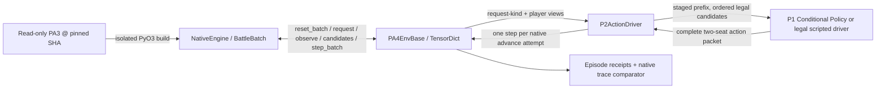

# PokeAgent 4.0 — P2 Detailed Design: Rust ↔ TorchRL Environment Adapter

**Document ID:** `PA4-P2-DESIGN-v1.0`  
**Prepared:** 2026-10-21 (KST)  
**Status:** DESIGN READY, NOT IMPLEMENTED  
**Parent:** `PA4-MASTER-ARCH-v1.2`  
**Predecessor:** P1 `PA4-P1-DESIGN-v1.0`, G1 PASS with explicitly CPU-scoped server verification  
**Next phase:** P3 — Batched Collector + InferenceServer  
**Authoritative source:** `mwl313/PA4`, `main` at `892f136f3704b773257a377c9a41c4fa50c74770` when inspected; verify new HEAD at execution.

> **Single objective:** Expose the unchanged, SHA-pinned PA3 Rust double-battle engine through a genuine TorchRL `EnvBase` / TensorDict contract. Demonstrate real, naturally completed battles with correctly synchronized two-seat decisions, correctly scoped player observations, accurate termination/reward semantics and reproducible native traces. **No Collector or PPO in P2.**

---

## 0. Decision summary and evidence boundaries

### 0.1 Pinned inherited facts (verified from PA4 P0/P1 receipts and code)

| Item | Actual P0/P1 evidence | P2 implication |
|---|---|---|
| Development | Windows 11 → WSL2 Ubuntu 24.04 as `pa4`, project `/home/pa4/projects/PokeAgent4.0` | Work inside this WSL tree only |
| GPU | RTX 4060 Ti 8GB | Correctness testing can stay CPU; no GPU throughput claim |
| Dependency stack | Python 3.12, `torch 2.9.1+cu128`, `torchrl 0.14.1`, `tensordict 0.14.3`, `uv.lock` SHA256 `8f414f526aad676f6466099da9bf96240f739abae9b9376a5c32fe845340d96e` | Preserve lock and pinned behavior |
| PA3 reference | `65bc980abd8e0bbec14158b9ddc2884bb1726a4e` | Sole game-rule oracle; **not claimed to be the live production checkpoint** |
| Rust | Toolchain `1.90.0`, PyO3 `0.26`; P1 compiled in isolated scratch `/home/pa4/.pa3_build` | Reuse build if provenance verifies; otherwise rebuild only isolated scratch |
| P1 policy | Actual PA3 `PA3Model`, 9,889,755 params, randomly initialized | No trained-policy or strength claims |
| Conditional actions | **B-path: staged prefix** from Rust candidates, max 4 branch slots, capacity 64; candidate order unchanged | Do not alter the conditional sampler, scorer, or legality |
| P1 replay | Saved candidate rows/masks/refs/indices and FP32 logprobs, replay delta 0.0 on tested fixtures | Preserve P1 protocol and replay identity; training persistence is P4 |
| P1 server | Actual `ProcessInferenceServer`, `process_slot` transport; 2-client CPU smoke | **No verified GPU central inference, no demonstrated server-side batching** |
| P1 tests | 39 `unittest` tests passing; G1-D CPU-scoped | Run P1 regression, never reinterpret as GPU PASS |
| P1 limitations | Small fixtures, observed max K=18 **not global maximum**, no PA3 numerical golden comparison other than self-replay, auditor could not inspect WSL repo | P2 must use real game traces and fix audit access; retain limitations honestly |

**Traceability:** `docs/phases/P1/{FINAL_REPORT.md,RECEIPT.json,ACTION_DISTRIBUTION_DESIGN.md}`, `docs/phases/P0/{SOURCE_FREEZE.md,P1_HANDOFF.md}`, `docs/master/PA4_MASTER_ARCHITECTURE.md`.

### 0.2 Fixed decisions

1. A **native-batched, stateful** `PA4EnvBase(EnvBase)` owns one PyO3 `NativeEngine` containing a small number of Rust battle slots. `env.batch_size = torch.Size([N])` with `N=2` initially. Do not create one Python engine per seat.
2. One TorchRL `step` represents a **native battle advance attempt**, not a branch choice, not a single player's half-turn, and not a PPO row. Every requesting seat's **complete player action** is prepared before submission. A peer in `Wait`/`Finished` contributes no fictitious action.
3. Keep the **P1 action protocol outside the Rust env**: a tiny `P2ActionDriver` asks the Rust engine for per-seat requests/candidates, drives P1's staged policy or an engine-legal scripted choice, and submits completed actions as a fixed-layout TensorDict. The engine remains the only legality authority.
4. Rust `step_batch` remains the sole state transition. No Python Pokémon rules, fake battle stepping, C ABI port, or engine modification.
5. Observations stay **per player**. The environment may hold both seat observations for the driver, but a policy-facing view must expose only that player's view; never pass two-seat joint observations or hidden truth as one actor input.
6. Use an explicit terminal contract: per-seat reward, match-level `done/terminated/truncated`, winner/draw and operational-error handling. Reject silent conversion of failures, watchdog timeouts or invalid input to natural completed matches.
7. TorchRL `check_env_specs` must execute on a real native-backed EnvBase. A naive unconstrained `action_spec.rand()` cannot supply legal prefix-dependent tuples: expose a small legal **engine-sourced** random action path for TorchRL's spec/rollout checks, without creating a second rule system.
8. **Fast track:** one implementation path, a few seeded small real games, and five tightly scoped G2 gates. Performance scale, multi-process collector integration and learner work belong to later phases.

### 0.3 Explicitly excluded

- P3 `AsyncBatchedCollector`, multi-process worker pools, production `InferenceServer` scheduling, `ProcessSlotTransport` scaling, throughput claims, latency optimization or batching sweeps.
- P4 PPO/GAE/losses, optimizer, learner trajectories, actual policy training, checkpointing, policy quality evaluation.
- Multi-GPU, Runpod, Docker, CUDA Graphs, torch.compile, BF16/FP16 experiments, Rust rewriting, C ABI, full legacy PA3 suites, 1,220-team coverage sweeps.
- New environment semantics, reward shaping, hidden-opponent access, artificial terminal rewards, filtering/truncating real action candidates.
- Custom generic multi-agent framework, leagues, telemetry server, public dashboard, speculative refactors of P1's model/server.

**Stop rule:** If a change does not unlock G2-A through G2-E, defer it. A gate failure is not permission to rewrite the engine.

---

## 1. System boundary and ownership



**Critical separation:** the P1 `ProcessInferenceServer` may score requests for an integration smoke, but it is **not** the TorchRL Collector. The P2 adapter may not require the CPU server to exist just to construct or reset an EnvBase. Server-driven and scripted-action tests share the exact same `_step` path.

### 1.1 Ownership table

| Component | Owns | Does not own |
|---|---|---|
| `NativeEngine` (unchanged) | Rules, RNG, public player view, candidates, accept/reject, round advance, terminal/winner | PyTorch, rewards for PPO, policy choice |
| `PA4EnvBase` | Native handles, reset/step, TensorDict/specs, fixed batch shapes, terminal/winner translation, episode/match accounting | Legal-action generation, logits, PPO or inference service |
| `P2ActionDriver` | Ask which seats require choices; collect full P1 prefixes, reconstruct exact action tuples, enforce seat-action barrier | Modify legal set, simulate engine state |
| `LegalRandomDriver` | Choose one of **engine-provided** candidate tuples at each prefix, deterministic via local seed | Independently calculate legality or invent filler actions |
| `TraceComparator` | Execute identical input actions on a second pinned native engine, compare observations, public requests and outcomes | Declare parity from self-comparison alone |
| `P1 action modules` | Prefix-dependent scorer, logprob/replay, bounded candidate tables, server probe | Battle stepping, joint two-seat orchestration |

### 1.2 PA3 native entry points (verified in pinned source)

- `pa3_engine.NativeEngine(data_dir, teams_json, workers)`
- `reset_batch(team_a, team_b, seeds, role_map)` → `[(slot, generation), ...]`
- `reset_slots_batch(slots, team_a, team_b, seeds, role_map)` for isolated partial refill
- `request_kind(slot, generation, side)` and `request_branches(...)`
- `observe_fixed_batch(handles, sides)`; P1 `NativeReference.observe_batch` wraps canonical parsing
- `candidates_batch([(slot, generation, side, prefix), ...])` → ordered native candidate tuples
- `step_batch([(slot, generation, [(side, [tuple6,...]), ...]), ...])` → `(accepted, terminated, truncated, winner, operational_error, request_kind_a, request_kind_b)`
- `snapshot`, `restore`, `enable_trace`, `export_trace` are available but P2's comparator may prefer deterministic fresh dual engines. Confirm signatures before use; do not invent wrappers.

Action tuple order: `(kind, own_slot, move_slot, target_location, switch_destination, resource)`; target is **signed** (do not clamp). `RequestKind`: Preview=0, Normal=1, Replacement=2, Wait=3, Finished=4. `CANDIDATE_PADDING = 64`, branch capacity 4. P1 already proved overflow raises.

---

## 2. TorchRL EnvBase contract (P2 target design)

### 2.1 Batch model and lifecycle

- `EnvBase.batch_size = torch.Size([N])`; `N=2` first, optionally `N=4` solely to exercise batched native calls.
- `EnvBase.device = cpu` for native observation/step tensors; a separate policy service may move observations to CUDA. Do not implicitly claim GPU simulation.
- One Rust `BattleBatch` slot per row; each row has immutable current native `(slot,generation)` until explicitly reset.
- Every native-slot reset updates its local `generation`, `episode_id`, teams/seeds and per-seat request sequence, and evicts any P1 cached request states if the driver has one.
- Do **not** key a policy cache by `slot` alone; use a unique request identity including episode/generation, seat and request sequence, and an explicit policy version. Fail closed on stale action response.
- Native match counting is by **unique naturally terminated episode** only. Collectors and P4 own later `accepted_training_matches` accounting.
- `reset()` can take fixed test input seeds/teams, or deterministic defaults from `_set_seed`. Never use process-global `random.seed()` to alter unrelated users of RNG.
- `reset_slots_batch` is used for partial reset; verify an unrelated live slot retains its handle and state. If TorchRL private `_reset` masking behavior requires handling, use the installed version's documented contract; no fake full reset.

### 2.2 A single environment step

A correct step follows this **atomic submission boundary**:

1. Read native request kinds and branch-slot counts for **both seats** from the current Rust state.
2. For every seat in `{Preview, Normal, Replacement}`, obtain the complete ordered prefix (`<=4` canonical tuple6 rows) using P1's staged sampler or legal scripted driver. Each branch's candidate table is fetched **after** preceding picks; preserve engine candidate order.
3. For `Wait` and `Finished`, do not invoke the policy and do not fabricate a `Pass` or empty actor row. Native submission includes only seats currently requesting a decision, according to the Rust API's accepted protocol.
4. Validate action packet against **current** `slot/generation/request_key`, branch count, candidate membership and requesting seats. The packet must not silently override one seat with a default action.
5. Submit exactly one `step_batch` call for the active env slots, passing each slot's set of complete per-seat actions.
6. On `accepted=True`, fetch the new public requests/observations, translate flags and expose next TensorDict. If naturally terminated, commit **one match**, not one per seat.
7. On `accepted=False` without operational error, treat it as a **native request revision** (not a fictitious loss or terminal). Re-fetch request kinds/observations; any already-committed waiting peer is not replayed. Evict stale request caches. Return a valid nonterminal transition with explicit `request_revised=True`, zero terminal reward; the following policy decision uses the revised request.
8. On a malformed/unaccepted invalid action exception or `operational_error`, fail closed: raise/log a real error, do not count a completed match, do not silently start a replacement episode.

**One native advance attempt can represent zero or one newly completed natural matches per env slot.** There is never a metric in P2 that counts policy branches or seat requests as matches.

### 2.3 Decision barrier and deadlock prevention

- If **both seats request** a decision, both completed player requests are prepared before the engine transition.
- If **only one seat requests** a decision and the other is `Wait`, submit the requested side only; the next request may still be revised by the native engine. The adapter must not block waiting for a second decision which the engine does not request.
- If **neither seat requests** and the episode is not terminal, classify as a protocol ambiguity and fail with trace evidence. Do not busy-spin.
- The driver must handle `Preview` (4 picks), `Normal` (2 slots), `Replacement` (1–2 active replacements), `Wait`, `Finished`; other unsupported variants are surfaced as blockers.
- A seat may have all branch sizes `K=1`; it still must submit the deterministic complete action if the engine requests one, but **does not** create an actor-learning row.

### 2.4 TorchRL TensorDict fields and exact shape proposal

Set all specs **before** running `check_env_specs`; verify actual constructor names (`Composite`, `Unbounded`, `Categorical`, etc.) in installed `torchrl==0.14.1`. The shapes below are **proposal contracts** for implementation and must be written as a versioned `TENSORDICT_SPEC.md`. Shapes include leading `N` EnvBase batch dimension.

**Environment input (single native advance attempt):**

| Key | Shape, dtype | Meaning |
|---|---|---|
| `action` | `[N,2,4,6]`, `int64` | Ordered native six-field atomic actions, per seat, max 4 branches |
| `action_branch_count` | `[N,2]`, `int64` | Number of valid prefix actions for each seat, 0 for `Wait`/`Finished` |
| `action_present` | `[N,2]`, `bool` | Seat currently submits a full decision |
| `action_request_id` | `[N,2]`, `int64` | Identity from current public request; used to reject stale responses |

The `action` tensor's padded rows **must never be submitted** to Rust. Use `action_branch_count` to slice exactly the real, fully selected prefix. `branch_count>4`, negative counts, inconsistent masks, stale request IDs, or extra actions for `Wait` are hard errors.

**Environment observation/state:**

| Key | Shape, dtype | Meaning |
|---|---|---|
| `players.token_mask` | `[N,2,96]`, `bool` | Per-seat visible tokens |
| `players.categories` / `players.category_known` | `[N,2,96,32]`, `int64` / `bool` | Categories and knownness |
| `players.floats` / `players.float_known` | `[N,2,96,50]`, `float32` / `bool` | Floats and knownness |
| `players.flags` / `players.flag_known` | `[N,2,96,40]`, `bool` / `bool` | Binary state and knownness |
| `players.role_ids` / `players.side_ids` | `[N,2,96]`, `int64` | Layout metadata sourced from pinned decoder |
| `players.observation_valid` | `[N,2]`, `bool` | Whether a player-facing observation applies to this transition |
| `players.request_kind` | `[N,2]`, `int64` | 0–4, from Rust only |
| `players.decision_required` | `[N,2]`, `bool` | True only for Preview/Normal/Replacement |
| `players.request_id` | `[N,2]`, `int64` | Must change when native request is revised or episode reset |
| `players.branch_count` | `[N,2]`, `int64` | Real native branch count (0 for Wait/Finished) |
| `native_slot` / `native_generation` | `[N]`, `int64` | Handle lifetime traceability, not policy features |
| `episode_id` / `step_index` | `[N]`, `int64` | Strict per-slot accounting |
| `request_revised` | `[N]`, `bool` | Native accepted=False with no error |
| `match_completed` | `[N]`, `bool` | Emits at most once per natural episode |
| `winner` | `[N]`, `int64` | `0`, `1`, or `-1` for natural draw/unknown; distinguish from error via done flags |

**Outputs on step:**

| Key | Shape, dtype | Semantics |
|---|---|---|
| `reward` | `[N,2,1]`, `float32` | Seat 0 and seat 1 rewards; only terminal natural result pays |
| `done` | `[N,1]`, `bool` | `terminated OR truncated` |
| `terminated` | `[N,1]`, `bool` | Natural game conclusion per Rust outcome |
| `truncated` | `[N,1]`, `bool` | Native-declared truncation, **not** P2 harness timeout |
| Fixed-key invariant | — | Every state/step uses the same TorchRL Composite keys; no request-kind-dependent optional keys |

**Terminal reward rule:** normal win → `(+1,-1)` or `(-1,+1)` according to native winner index; natural draw → `(0,0)`; intermediate step → `(0,0)`. A native truncation is not silently scored as a win or natural completion. If engine semantics permit `terminated and truncated` simultaneously, record exact native flags and classify explicitly rather than inventing a rule.

**Important privacy boundary:** `players` is an **internal two-seat environment output** for the action driver. The actor receives **only** `players[:, seat]` via an explicit `player_view(seat)` or documented equivalent. Engine-private state, unseen enemy roster details, random seed, opposing player observation and the other player's action history **must not** enter that actor view. Verify unknownness masks, not just numeric zeros.

### 2.5 TensorDict timing, reset and `next` semantics

- `_reset(tensordict)` returns the current observation/state and `done/terminated/truncated=False` for newly reset slots. No `reward` is fabricated as an already executed transition.
- `_step(tensordict)` returns **post-transition** state fields, reward and done flags. TorchRL's public `env.step()` will place them under `"next"`; tests must not manually create a conflicting `next` input.
- For partial reset, use TorchRL's recognized `"_reset"` mask. Do not ignore it and reset all N slots, which can silently lose still-active matches.
- Terminal observations: keep all TensorDict shapes fixed. If native cannot supply a meaningful next view for a `Finished` seat, set `players.observation_valid=False`, `players.decision_required=False`; use **explicit neutral padding** and do not assert padded data is a real player observation.
- The default random action spec may generate invalid Pokémon actions. The P2 legal-random adapter must fetch staged candidates from the engine and produce complete legal action packets; ensure `check_env_specs` uses this real legal path. **Never bypass `check_env_specs` by weakening dtype/spec checks or monkeypatching no-op transitions.**
- Under the installed TorchRL API, test whether a legal `rand_action()` override or a standards-compatible policy callback is the smallest way to exercise spec checks. Document the selected option; no custom TorchRL fork.

---

## 3. Work packages (strictly sequenced)

### P2-0 — Preflight and scope freeze

**Owner:** `pa4-lead` (DeepSeek), sole writable agent.  
**Inputs:** `docs/master/PA4_MASTER_ARCHITECTURE.md`, P0/P1 receipts, P1 action code, actual `HEAD` and clean/dirty status.

1. Launch from WSL2: `cd /home/pa4/projects/PokeAgent4.0 && opencode`; verify auditor can read repo-internal P1 files. The P0/P1 audit reachability limitation is not acceptable as an unqualified independent review for P2.
2. Verify clean writable PA4 worktree; preserve any changes rather than overwriting. Record actual base SHA and `uv.lock` SHA256.
3. Confirm Rust 1.90 and the **isolated** PA3 native module import; verify source SHA and observation contract before constructing the adapter.
4. Re-run existing P1 tests once. Do **not** rerun the whole legacy PA3 test corpus.
5. Fix only blockers to G2; no unrelated P1 re-architecture, no dependency version sweep.

**Exit:** Known good native binding and action gateway, repository isolation and pinned tools. This is a preflight, **not** an additional G2 gate.

### P2-A — Native-backed EnvBase, spec, reset and observe

**Add only:** `pa4/env/native_env.py`, `pa4/env/specs.py` (or one compact module), `tests/environment/test_env_contract.py`.

- Implement `PA4EnvBase` backed by `NativeReference`/`NativeEngine`; one native engine instance owns N battle slots. Preserve original API wrappers and do not duplicate observation decoding.
- Implement `_set_seed`, `_reset` and spec definitions; initial default N=2.
- Build two-seat state observations from **native side-specific** views. Expose `request_kind`, `branch_count`, `decision_required`, unique request key, slot/generation, episode/step counters, terminal flags.
- Implement `player_view(seat)` or an equivalent unambiguous extraction method that returns no other-seat info.
- Implement a legal random action pathway sourced solely from Rust candidates. No new legality function.
- Verify shape/dtype with real `check_env_specs` for a tiny native-backed rollout (no mocks).

**Exit:** Real native reset/observe and TorchRL API/spec check, without training.

### P2-B — Complete-action submission, two-seat barrier and transitions

**Add only:** action packet assembler/driver in `pa4/env/action_driver.py` and a bounded number of tests in `tests/environment/test_battle_step.py`.

- Use P1 conditional modules as-is where possible; for quick seeded rollouts use an engine-legal scripted driver. It must traverse per-seat prefixes and preserve candidate order.
- Translate each seat's completed decision into exactly `branch_count` canonical tuple6 rows. `Wait`/`Finished` supply none.
- `_step` submits all currently requesting seats together through **one** native `step_batch` call per env advance attempt.
- Reject stale handle, stale request ID, invalid `action_present`, malformed tuple and wrong branch count. Do not silently default actions.
- Translate Rust accepted/revision, winner, terminated and truncated exactly; update per-seat public requests and observations after step.
- Keep match count at most once per unique naturally completed episode. Preserve nonterminal zero reward.

**Exit:** Real full battles can run without invoking PPO/Collector.

### P2-C — Minimal native oracle / deterministic episode trace

**Add only:** `pa4/env/trace_compare.py` or a concise test helper, `tests/environment/test_episode_parity.py`, and small deterministic fixture seed/team IDs.

- Run a small set (suggest 4–8) of fixed-seed **natural full battles** using engine-sourced scripted choices (not mock combat). Verify termination, no operational errors, 0 illegal actions, one completion per episode, correct winner/reward mapping and action/seat accounting.
- Use **two independently created native engines** at the same pinned SHA with identical team/seed/roles and exact action tuples. Compare at every state boundary: both public request kinds, both view payloads/decoded masks, ordered legal candidate lists for selected prefixes, native step result, winner and final termination. Never compare only PA4's own output to itself.
- At least one real P1 staged-policy two-seat action packet must successfully traverse EnvBase `step()` and match direct native `step_batch` semantics. Full CPU-server-driven match is **not required** when it would dominate P2 runtime; no GPU claim.
- Verify deterministic reset same seed+teams+roles gives same native trace, and a partial slot reset leaves the other active slot intact.
- Verify a `Wait` request and a `Finished` state in naturally observed traces; replacement handling must be exercised with a real native state if accessible. If not reached, record the gap with **PARTIAL** rather than fabricate a replacement fixture. Use an existing real PA3 fixture only if it can be reproduced without altering rules.
- Verify actor privacy with a two-view knownness/mask check and/or the existing native hidden-opponent metamorphic fixture, restricted to a few focused cases.

**Exit:** Independent seeded trace parity and natural game completion are evidenced.

### P2-D — Focused audit, evidence and Gate decision

**Add only:** `docs/phases/P2/{TENSORDICT_SPEC.md,EPISODE_TRACE_REPORT.md,FINAL_REPORT.md,RECEIPT.json}` plus small status/decision updates.

- Run the five gate checks once after implementation; focused bug fixes only.
- Have `pa4-auditor` (fresh context, no write/shell/task) **read the actual WSL repo files** and inspect the Diff, interfaces, specs, error/reward accounting and test outputs. The Lead executes objective tests; the auditor only reviews.
- Update `docs/PROJECT_STATUS.md`, and `docs/DECISIONS.md` only for a genuine design choice or blocker. Record exact source/hash, commands, versions and limits. Commit tested code; then receipt/report in separate metadata commit to avoid self-referential SHA.
- Stop, even on PASS. Do not initiate P3 automatically or perform benchmarking.

---

## 4. Minimal verification Gate G2

The five checks below are the **entire P2 gate**. Small targeted subcases within the named tests are allowed; do not create a sprawling test framework.

| Gate | Exact PASS requirement | Required evidence | Not required |
|---|---|---|---|
| **G2-A: Real EnvBase spec** | Native-backed `reset` and `step` with true `EnvBase`, fixed TensorDict keys/shapes/dtypes, `check_env_specs` succeeds with legal actions, no mock replacements | Actual `check_env_specs` command/output, `TENSORDICT_SPEC.md` | ParallelEnv, Async Collector, large batch |
| **G2-B: Battle & action barrier** | At least 4 distinct seeded **naturally completed** native games; valid two-seat submission incl. Wait/Finished behavior, 0 invalid submissions, 0 operational errors, rewards/term/trunc exactly match native, unique completion per episode | `test_battle_step`, seeded trace/result counts, exact rewards | PPO, trained wins, full league |
| **G2-C: Deterministic source parity** | Independently created native oracle and PA4 adapter agree on both sides' request kind, player-visible observation, ordered candidates for sampled prefixes, step result and episode outcome for same seeds+teams+actions; partial reset preserves unrelated slot | `test_episode_parity`, per-field mismatch report if any | Every game state or 1,220 teams |
| **G2-D: Hidden info and lifetime safety** | Player view excludes other side and engine-private info; knownness masks stay intact; stale slot/generation/request key rejected; non-native timeout/exception never becomes a completed battle | Targeted privacy/staleness negative checks | Cryptographic privacy proof, distributed retries |
| **G2-E: P1 integration & audit** | At least one P1 staged two-seat policy packet crosses the real EnvBase/native boundary; old P1 39 tests remain green; pinned lock/engine unchanged; actual PA4 WSL files reviewed by read-only auditor | P1 regression output, integration trace, auditor scoped report, lock/source status | GPU server throughput, PA3 golden PPO parity |

**PASS requires all five gates.** `PARTIAL` means an honest limited implementation with documented failed/unverified gate(s). `BLOCKED` means a required contract cannot be established. Never reinterpret PARTIAL as PASS merely because a few battles finished.

**No arbitrary 1,000/s performance threshold.** P2 may report elapsed time as diagnostic evidence but should not benchmark or optimize around it. 4060 Ti CUDA policy throughput, ProcessSlotTransport under load and worker concurrency belong to P3.

### 4.1 Expected small test organization

```text
pa4/
  env/
    __init__.py
    native_env.py
    action_driver.py
    specs.py                 # only if needed
    trace_compare.py         # only if needed

tests/
  environment/
    __init__.py
    test_env_contract.py
    test_battle_step.py
    test_episode_parity.py

docs/phases/P2/
    DESIGN.md                # this document copied verbatim
    TENSORDICT_SPEC.md
    EPISODE_TRACE_REPORT.md
    FINAL_REPORT.md
    RECEIPT.json
```

Do not add dependencies merely for P2 tests. Use Python stdlib `unittest` and installed TorchRL, TensorDict and PyTorch. **No pytest addition to frozen lock** unless an objective hard blocker requires an explicit ADR.

### 4.2 Suggested commands (confirm against actual installed APIs)

```bash
cd /home/pa4/projects/PokeAgent4.0
uv sync --frozen
uv run --frozen python -m unittest discover -s tests/action_distribution -t .
uv run --frozen python -m unittest discover -s tests/environment -t .
# The EnvBase test suite must invoke the *real* torchrl.envs.check_env_specs.
git diff --check
sha256sum uv.lock
git status --short
```

Tests should exit nonzero on failure even under Python `-O`: use explicit exceptions/assertions from `unittest` rather than standalone optimizable bare `assert` statements. Logs shall report test counts and exact failed assertions; no unverifiable PASS strings.

---

## 5. Failure handling and scope control

| Failure | Response | Boundary |
|---|---|---|
| EnvBase spec mismatch | Correct spec/layout per installed TorchRL 0.14.1 contract, rerun targeted spec test | No spec validation bypass or TorchRL patch |
| `check_env_specs` generates invalid random action | Make its legal-random route consult native candidate tables; verify public EnvBase policy/rand_action hook | No fake/empty step, no fabricated legal set |
| Two seats desynchronize | Inspect native request-kind transitions; submit only requested sides, use request revision path | No automatic default Pass, no busy spin |
| Native `accepted=False` | Surface revision, refresh public request, invalidate stale pending choice, continue without completion/reward | Do not call it terminal or operational error unless native says so |
| Native raises invalid-input | Fail closed, print sanitized slot/seat/request evidence and stop the affected episode | No catch-and-continue that records victory |
| Stale P1 server request after reset | Evict request cache, version request identity and reject late responses | No stale GRU state reuse |
| `Wait` / `Finished` causes absent view | Keep fixed specs and observation-valid mask; no policy call | Do not substitute unseen/private state |
| Seed replay mismatch | Identify whether reset teams, roles, native request and RNG were equal; compare first divergent transition | Do not relax equality to hide mismatch |
| Replacement not exercised | Reuse a reproducible real fixture or report `PARTIAL` with missing evidence | Never forge request type via fake mock engine |
| P1 policy on CPU is slow | Use scripted real legality for complete-game regression and P1 for one genuine boundary crossing | No CUDA rewrite or GPU benchmark in P2 |
| Auditor cannot read WSL repo | Start Lead from WSL-native OpenCode and verify auditor read of real file before final PASS | Inline-only review is not a P2 independent file review |
| Candidate overflow >64 | Raise; record observed state; propose a focused contract ADR for P1 | Never drop/reorder actions to fit |
| Genuine source contract incompatibility | Mark BLOCKED, document exact Rust/Python interface mismatch and proposed smallest repair | Do not mutate protected PA3 |

Limit exploratory repair to one focused hypothesis per failure and a bounded second test. If a gate stays unproven, stop with an actionable `PARTIAL`/`BLOCKED` report instead of spiraling into unrelated refactors.

---

## 6. Deliverables and evidence schema

Mandatory P2 deliverables:

1. **Native-backed `PA4EnvBase`** and a single legal staged action-driver path with correct two-seat submission.
2. **TorchRL spec receipt:** `TENSORDICT_SPEC.md`, real `check_env_specs` logs and documented fixed key/dtype/shape contract.
3. **Episode trace comparator** and a small reproducible seed/team suite showing both-seat parity vs a separate native oracle.
4. **Focused tests** of the five G2 gates, including P1 regression and one P1-policy boundary integration.
5. **`docs/phases/P2/FINAL_REPORT.md`** explaining code changes, gate evidence, limitations, selected EnvBase action boundary and P3 handoff.
6. **`docs/phases/P2/RECEIPT.json`** with immutable references and measured values, plus clean Git commits.

### 6.1 Minimal `RECEIPT.json` schema (fill from actual data only)

```json
{
  "phase": "P2",
  "design_id": "PA4-P2-DESIGN-v1.0",
  "verdict": "PASS_OR_PARTIAL_OR_BLOCKED",
  "pa4_base_sha": "ACTUAL_FULL_SHA",
  "pa4_tested_code_sha": "ACTUAL_FULL_SHA",
  "pa4_final_head_sha": "ACTUAL_FULL_SHA",
  "pa3_reference_sha": "65bc980abd8e0bbec14158b9ddc2884bb1726a4e",
  "dependency_lock_sha256": "8f414f526aad676f6466099da9bf96240f739abae9b9376a5c32fe845340d96e",
  "torch": "ACTUAL_VERSION",
  "torchrl": "ACTUAL_VERSION",
  "tensordict": "ACTUAL_VERSION",
  "rust": "ACTUAL_VERSION",
  "real_envbase": null,
  "check_env_specs_pass": null,
  "native_engine_build_source_verified": null,
  "naturally_completed_matches": null,
  "operational_errors": null,
  "illegal_submissions": null,
  "duplicate_completion_ids": null,
  "trace_parity_first_mismatch": null,
  "partial_reset_pass": null,
  "wait_finished_observed": null,
  "replacement_observed": null,
  "p1_action_packet_integration_pass": null,
  "p1_regression_test_count": null,
  "auditor_read_actual_wsl_repo": null,
  "gates": {
    "G2_A": "UNTESTED",
    "G2_B": "UNTESTED",
    "G2_C": "UNTESTED",
    "G2_D": "UNTESTED",
    "G2_E": "UNTESTED"
  },
  "limitations": [],
  "notes": "Never replace null/unmeasured fields with guessed metrics. Record command evidence."
}
```

**Commit handling:** test code and commit its SHA first; record receipt against that tested implementation; commit receipt/status in a subsequent metadata commit. Do not try to include a commit's own SHA inside itself. State final HEAD separately.

### 6.2 P3 handoff contract (record, do not implement)

P3 receives:

- Native `PA4EnvBase` shape and side/episode/request semantics.
- Explicit `action` packet schema, acceptance/revision behavior, native handle lifetime, return dtype/shape and observation privacy boundary.
- P1 `ENCODE/STEP/RESET` cache semantics and per-request policy version bound to the action packet.
- Real `check_env_specs` and small natural-game traces from G2.
- Explicit remaining limitations: **P1 central server CPU only**, no proven GPU server throughput/batching; production worker `ProcessSlotTransport`/Collector concurrency untested, PA3 reference pinned only to public SHA, P1 replay needs original observation payload.

P3 shall not assume one native `step` equals one completed match, nor one TensorDict frame equals one accepted PPO training row. It must not expose opponent/private info to a seat policy.

---

## 7. Reference links and code locations

### PA4 current-source references (inspect HEAD at implementation)

- Repository: https://github.com/mwl313/PA4
- P1 receipt: `docs/phases/P1/RECEIPT.json`
- P1 report: `docs/phases/P1/FINAL_REPORT.md`
- P1 action flow: `pa4/actions/{native_reference.py,conditional_policy.py,server_probe.py,server_factory.py}`
- PA4 master: `docs/master/PA4_MASTER_ARCHITECTURE.md`

### SHA-pinned PA3 code

- `engine/src/python.rs`: PyO3 batch interface and StepResult
- `engine/src/batch.rs`: battle group handles and step/reset
- `engine/src/actions.rs`: branch candidates / request-kind semantics
- `agent/train/native_collector.py`: reference two-seat / request/reward handling
- `agent/model/pa3_model.py`: sampled prefix and FP32 logprob math
- `agent/types/{actions.py,requests.py,observation.py}`: canonical tuples and observation mapping

### TorchRL reference documentation (reconfirm names in pinned installed 0.14.1)

- EnvBase: https://docs.pytorch.org/rl/stable/reference/generated/torchrl.envs.EnvBase.html
- Environment API: https://docs.pytorch.org/rl/stable/reference/envs_api.html
- check_env_specs: https://docs.pytorch.org/rl/stable/reference/generated/torchrl.envs.check_env_specs.html
- Partial resets: https://docs.pytorch.org/rl/stable/reference/envs_vectorized.html

---

**Final rule:** P2 exists to prove the **battle-environment boundary**: complete real games, synchronized seats, player-private observations, native RNG/rules and correct rewards. It does **not** prove Collector scalability, PPO stability, agent strength or 1,000 matches/s. Stop after the G2 receipt and handoff.
