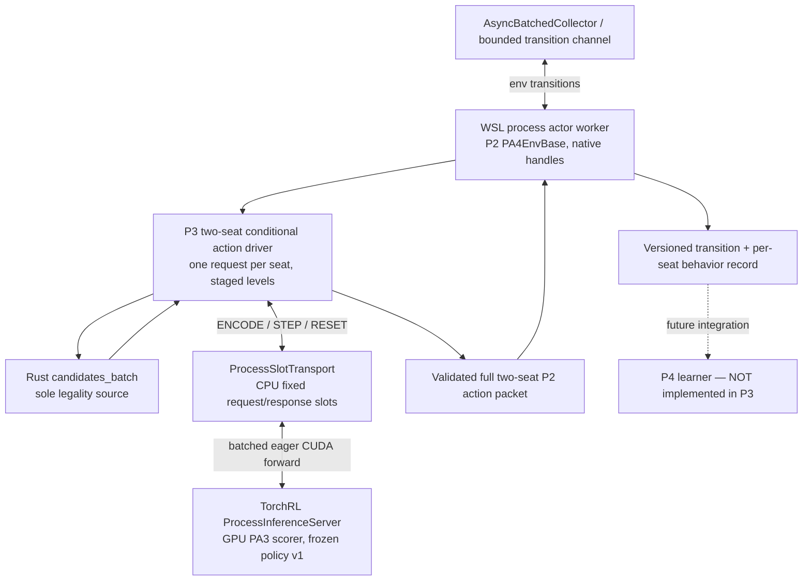

# PokeAgent 4.0 — P3 Detailed Design: Batched Collector and Central Inference

**Document ID:** `PA4-P3-DESIGN-v1.0`  
**Prepared:** 2026-10-22 (KST)  
**Status:** DESIGN READY, NOT IMPLEMENTED  
**Parent:** `PA4-MASTER-ARCH-v1.2`  
**Predecessor:** P2 `PA4-P2-DESIGN-v1.0`, recorded G2-A–G2-E PASS  
**Authoritative repository inspected:** `mwl313/PA4`, `main` at `4d8f349b247bb929914db5b9ebe2c5ce84c18288`  
**Immutable PA3 reference:** `65bc980abd8e0bbec14158b9ddc2884bb1726a4e`  
**Next phase:** P4 — End-to-end On-policy PPO-2

> **One-line objective:** Integrate the *real* PA4 native double-battle environment and P1 conditional scorer into bounded asynchronous environment workers and one measurable **GPU-backed** central policy server, producing trustworthy, replayable, versioned transition batches. Preserve game legality, two-seat semantics, and exactly-once natural-match accounting. P3 is **actor/collector integration, not PPO training or a 1,000 matches/s certification**.

---

## 0. Evidence inherited from P0–P2; important limits

### 0.1 Source-backed state at design time

| Area | Observed in PA4 repository | Meaning for P3 |
|---|---|---|
| Repo | `main` `4d8f349...`; P2 tested *code* `136d333...`; intervening commits finalize receipts | Recheck `HEAD` and worktree before starting; don't equate metadata HEAD with tested-code commit |
| P0 | G0 4/4 PASS; WSL2 Ubuntu 24.04, RTX 4060 Ti 8GB | Develop/test in Linux WSL filesystem as user `pa4` |
| Frozen stack | Python 3.12, torch `2.9.1+cu128`, TorchRL `0.14.1`, TensorDict `0.14.3`, Rust `1.90.0` | Preserve `uv.lock`; no nightly/version sweep without reproducible hard blocker |
| P1 | 39 tests PASS, staged prefix B-path, four possible branches, maximum 64 candidate slots | No pre-computation of an unbounded whole joint-action tree |
| P1 inference | Real `ProcessInferenceServer` with `ProcessSlotTransport` exercised on **CPU**, two clients | **No evidence** of CUDA execution, one forward handling multiple clients, or concurrent cache safety under batched calls |
| P1 model | Real `PA3Model`, 9,889,755 params; random weights | No trained strength claim. Preserve the action scorer/FP32 reference semantics |
| P1 replay | `ActionReplayRecordV1`; replay tested, but caller must provide original observation | Collector must retain the *actual* behavior observation + ordered branch snapshot data |
| P2 | Real `PA4EnvBase(EnvBase)`, one native engine with `[N]` battle slots; `check_env_specs` PASS | Reuse existing reset, step, player view and TensorDict contracts |
| P2 evidence | 51 environment tests + 39 P1 regression PASS; 4 distinct naturally terminated games, 0 measured errors | Four games are enough for P2's gate, **not** a concurrency or throughput proof |
| P2 two-seat behavior | Complete player actions before `step_batch`; Wait/Finished submit nothing; Replacement/Wait asymmetry observed | Preserve the native two-seat barrier, not a fictional single-seat turn loop |
| P2 terminal/counters | Termination yields one natural match and two-seat rewards; truncation is separate, post-terminal flags preserved | Collector counts `match_completed` once per episode; no artificial timeout/truncation successes |
| Audit | P2 final WSL auditor read real code and returned CLEAN; auditor is same DeepSeek model | Require actual WSL repo read for P3 audit; tests remain authoritative |

**P2 PASS finding:** The gate verdict is supported by its submitted test and report receipts, including a prior false integration claim subsequently fixed. This is *repository-evidence review*, not a fresh execution of 90 tests on the user's host. See `docs/phases/P2/{FINAL_REPORT.md,RECEIPT.json,TENSORDICT_SPEC.md,EPISODE_TRACE_REPORT.md}`.

### 0.2 P2 carry-over issues that P3 must address, not hide

1. P1 `pa4/actions/server_probe.py::ConditionalScorerService.forward` uses `_scalar()` to select the **first** row of a potentially stacked request and stores entries under `(0, request_key)`; P1 measured two independent clients, **not an actual server-side batch >1**. P3 must process and return every distinct row without key collisions, preserving row order. Treat this as a real identified integration risk, not an established batching implementation.
2. P2 is **not** an autonomous acting environment: `PA4EnvBase._step` requires a completed six-key action packet for two seats. The native candidates for later branches depend on earlier choices. Therefore a conventional `AsyncBatchedCollector` policy callback cannot safely fabricate the whole action in one context-free call.
3. Existing P1 replay checks include a model fingerprint; hashing all model weights for *every request* would be inappropriate in the high-throughput actor path. Cache a verified fingerprint at immutable-policy publication; retain full replay verification in a dedicated validation path.
4. P2 `NativeOracle` uses the same observation decoder as PA4, so matching it does not independently prove decode correctness. P3 preserves the nine observation leaves and their knownness masks; no claim of independent decoder parity.
5. P2 has not observed a real native truncation; its truncation accounting was exercised via controlled proxy response. P3 tracks truncations distinctly and tests the fail-closed accounting path, but does not invent naturally truncating games.
6. P2 noted a missing native-result count guard (`zip` can mask missing results), an uncovered concluded-row branch-count edge and a few narrow test gaps. Add narrowly targeted checks where concurrency exposure makes them critical; **do not** expand into a general P2 rewrite.

### 0.3 Fixed decisions and non-goals

- **One writable agent:** OpenCode WSL2 `pa4-lead` (DeepSeek); a fresh `pa4-auditor` is read-only, with real repository read access. No Qwen, MiniDC coding/swarm or parallel writes.
- **Rust is sole authority** for legality, state transition, RNG, natural terminal and game outcomes. Do not change its rules or active PA3 repository.
- **Frozen behavior weights:** P3 collects with one immutable random-initialized PA3-equivalent policy version per run. No PPO, optimizer, learner, weight-update race or historical policy pool.
- **Hardware:** CPU native workers + central **CUDA eager FP32** policy service on RTX 4060 Ti 8GB. Small worker counts and bounded request queues. Avoid compile, CUDA graphs, AMP, DDP and aggressive tuning.
- **Scope:** implement a *minimal working collector path* plus defensible diagnostics. No performance target beyond truthful measurement, and no Runpod spending.
- **Do not** replace P2 `EnvBase` with a rewritten game loop or treat a dummy/synthetic action source as a valid behavior-policy integration proof.

---

## 1. The central P3 integration problem: staged actions vs standard Collector API

### 1.1 Facts that determine the architecture

The P2 environment makes **one TorchRL `step` per real native battle advance attempt**. A single advance can require the completion of four sequential branch selections per player at Preview, and up to two during Normal, while a non-requesting seat must do nothing. At each level, the Rust engine supplies legal `C_j(a_<j)` only *after* the prefix has been chosen.

TorchRL `AsyncBatchedCollector` ordinarily asks its policy for the environment action before calling `env.step()`. The P1 service's `ENCODE`, `STEP`, `RESET` protocol requires **multiple worker-to-server exchanges** to build one completed P2 action packet. It is **not** correct to assume an ordinary `TensorDictModule` makes this dependency disappear.

The *objective* is to bridge these protocols without forking TorchRL or copying game rules. Verify which hooks actually exist in the frozen TorchRL `0.14.1` source, not only the latest online documentation.

### 1.2 Preferred logical dataflow



The Rust environment state and the native candidate-query sequence must stay in the **same owning worker**. The server sees the *one-seat* observation and the ordered legal candidates for a branch; it must never receive the other seat's privileged view as an additional actor feature.

### 1.3 Integration plan and allowed narrow fallback

**Path P3-I (preferred): real `AsyncBatchedCollector` integration.** Create an actor-aware worker wrapper / policy-client adapter so a multiprocessing worker can (a) query its local native engine, (b) submit staged ENCODE/STEP/RESET to the shared server, (c) assemble the exact six-key P2 action packet, (d) call the real P2 `EnvBase.step`, and (e) emit a valid TorchRL transition. The outer Collector handles lifecycle, asynchronous delivery and backpressure. A wrapper is allowed to adapt the acting protocol; it must **not** implement Pokémon rules. Preserve the underlying P2 observation/action semantics and record how the external Collector action, if any, relates to the true server policy. A no-op outer policy must never be reported as the battle behavior policy.

**Compatibility proof comes FIRST.** Do not commit to undocumented hooks. With one worker, prove the above mechanism can run through the *installed* `AsyncBatchedCollector` while the real policy service produces the actual choices. Record which process owns each object and who starts/shuts down the server.

**Path P3-F (conditional fallback): narrowly custom TorchRL-compatible actor adapter.** If the P3-I smoke demonstrates an irreducible API mismatch, produce a short ADR with the exact unsupported interaction and test evidence. The minimal fallback can own the staged worker acting loop and use `InferenceServer` + `ProcessSlotTransport` directly, emitting ordinary TensorDict transitions with the same schema, immutable policy stamps and bounded queues. Do not fork or rewrite `AsyncBatchedCollector` internals. The full master requirement for Collector use remains an open compatibility delta: a fallback-only result must be labelled **PARTIAL against the preferred integration requirement** unless the user approves a master-alignment ADR and its evidence.

**Forbidden false passes:** a dummy policy causing the environment to take random actions, a serial two-client smoke, or calling TorchRL's class by name while bypassing its collector path does **not** prove P3-I.

---

## 2. P3 module boundaries, canonical types, process ownership

### 2.1 Proposed minimal additions

```text
pa4/
  collector/
    __init__.py
    actor_driver.py             # owns one worker's native request lifecycle
    env_factory.py              # top-level picklable factory, P2 EnvBase wrapper
    inference_bridge.py         # P1 op protocol, one seat at a time, guarded keys
    transition_contract.py      # per-seat behavior records, match identity
    run_actor_smoke.py          # finite, bounded actor-only live run
  actions/
    server_probe.py             # targeted vectorized-batch fix if needed
    server_factory.py           # targeted factory/device/identity changes
  env/
    native_env.py               # only narrowly justified P3 guard fix

tests/collector/
  test_collector_contract.py
  test_server_batch.py
  test_worker_isolation.py
  test_completion_accounting.py
  test_shutdown.py

docs/phases/P3/
  DESIGN.md
  INTEGRATION_DECISION.md
  TENSORDICT_TRANSITION_V1.md
  BATCHING_EVIDENCE.md
  PERFORMANCE_BASELINE.csv
  FINAL_REPORT.md
  RECEIPT.json
```

Names may be combined where that makes the result smaller. No generic registry, cloud SDK, dashboard stack, new model architecture, PPO learner or additional agent framework.

### 2.2 Process/ownership model

| Resource | Owner | Lifetime and invariant |
|---|---|---|
| `NativeEngine` + handles + RNG | Each actor worker, via P2 EnvBase | Never send live PyO3 handles across process boundaries |
| Rust legal candidate query | Same actor worker | Source of all staged candidates, no Python-generated alternatives |
| P2 environment `step` and terminal accounting | Worker-local EnvBase | One native step attempt per TorchRL step, no double commit |
| Actor-observation slice | Worker; one requesting seat | Only nine seat-visible leaves and own request metadata to server |
| `InferenceClient` | Worker; one dedicated owned transport slot | One outstanding request at a time per slot; request and response buffer not reused early |
| `ProcessSlotTransport` | Server/collector management context | Fixed *unbatched* CPU TensorDict layout; slot count explicitly bounded |
| PA3 policy weights and request cache | One inference server process | One immutable policy version per run, no multiprocess weight writes |
| `ActionReplayRecordV1` + observation | Worker / transition store | Store actual observation payload; stable candidate order and indices; no resampling |
| Transition chunk and ledger | Collector driver | Exactly-once per `(run_id, worker_id, episode_id, native_generation)` natural completion |
| Auditor | Read-only DeepSeek OpenCode context | Read actual WSL repo; cannot execute or write |

`run_id`, `worker_id`, `episode_id`, `native_generation`, `native_slot`, `seat`, `request_id`, `policy_version` identify each sample. **Do not use request_id alone**: P2 resets it to `(1,1)` per episode. Native slots and request keys can repeat in different workers. Use a collision-free bounded request namespace (e.g., monotonically allocated worker-local integer plus explicit worker ID) and reject overflow or reuse; never rely only on a collision-prone hash of this tuple.

### 2.3 Two-seat actor pseudocode (semantic, not an implementation recipe for TorchRL internals)

```python
for worker_env in running_envs:
    obs_td = worker_env.current_observation()
    action_packet = empty_p2_packet_with_required_identity(obs_td)
    per_seat_records = []
    for seat in (0, 1):
        request = get_native_request_from_worker(worker_env, seat)
        if request.kind in (WAIT, FINISHED):
            # action_present=False, count=0; do not invent PASS
            continue
        view = select_player_view_only(obs_td, seat)
        key = allocate_request_key(worker_id, episode_id, seat, request_id)
        try:
            remote_encode(key, view, policy_version)
            prefix, snaps = [], []
            for level in range(request.branch_count):
                c_j = worker_env.native_candidates(seat, prefix)
                selection = remote_step(key, level, c_j, policy_version)
                validate_selection_and_identity(selection, c_j)
                prefix.append(c_j[selection.index])
                snaps.append(snapshot_branch(c_j, selection))
            action_packet.set_seat(seat, prefix, required_p2_identity(obs_td))
            per_seat_records.append(make_behavior_record(view, snaps, policy_version))
        finally:
            # RESET on success, failed response, revision, cancellation and teardown
            remote_reset_if_possible(key)
    next_td = worker_env.step(action_packet)  # EXACT P2 path
    validate_and_emit_transition(obs_td, action_packet, next_td, per_seat_records)
    # On accepted=False revision, drop obsolete per-request records and resample.
```

The exact implementation may group same-level requests across workers in the inference service. This pseudocode is **not** authorization to create an independent game-step implementation; `worker_env.step()` must remain the only state transition. In a worker with multiple native rows, explicitly support every row or restrict the P3 factory to `batch_size=1` and prove its TorchRL shapes; do not silently process only index zero.

### 2.4 Policy and recorder boundaries

The server does **not** decide which seat acts, fabricate legal action tuples, or advance a battle. The driver does **not** compute new neural logits outside the shared policy model. Per-branch candidate references and `active_to_roster()` must use the requesting seat's decoded observation, preserving the P2 fix for non-PICK actions. The snapshot stores action tuples as **signed** canonical six-field integers. It must not clamp negative targets or silently slice the candidate list at 64.

At any failed operation, report an **operational failure** or a real Rust revision. Neither becomes a synthetic loss, terminal or accepted match. Retried requests use new request identity and restart server hidden/cache correctly.

---

## 3. P3 TensorDict data contracts

### 3.1 Inherited P2 input/output: DO NOT invent replacements

P2 `docs/phases/P2/TENSORDICT_SPEC.md` is authoritative:

- Input `action [N,2,4,6]` int64, `action_branch_count [N,2]`, `action_present [N,2]`, plus all three mandatory identity arrays `action_request_id`, `action_episode_id`, `action_native_generation`.
- Observation `players.*` nine numeric/mask leaves, plus `observation_valid`, `request_kind`, `decision_required`, `request_id`, `branch_count`; outer `native_slot`, `native_generation`, `episode_id`, `step_index`, `match_completed`, `winner`, `request_revised`.
- Output `reward [N,2,1]` float32; `done/terminated/truncated [N,1]` bool. One match counts once, even though both seats can generate learner rows later.
- `Wait/Finished` must have no action. A concluded row accepts only `present=False`, count 0, preserves original terminal flags.

The P3 adapter may **append** metadata or wrap the environment, but P2 keys, shapes and meaning must remain unchanged. Any P2 modification requires one focused compatibility rationale and full P1/P2 regression.

### 3.2 `PA4ActorTransitionV1` (new append-only collector envelope)

**Required per environment transition**, with run-specific IDs stored outside the policy-visible view:

```yaml
schema_version: pa4.actor_transition.v1
run_id: immutable_id
worker_id: stable_worker_namespace
native_slot: int
native_generation: int
episode_id: int
step_index: int
request_ids: [int, int]
policy_version: int
policy_weight_fingerprint: sha256_or_registry_reference
observation_contract_hash: pinned_sha256
next_observation: per_seat_p2_visible_data
real_p2_action_packet: six_required_fields
reward: [seat0, seat1]
done: bool
terminated: bool
truncated: bool
match_completed: bool
winner: int_or_minus_one
request_revised: bool
seat_records: [per_seat_behavior_record_only_if_decision]
```

`seat_records` hold `seat_id`, the **pre-action** nine-leaf observation (not just a digest), `request_id`, `actor_active`, `joint_logprob_fp32`, and each branch's ordered candidate tuples, legal masks, token refs, selected index, `branch_k`, branch logprob, and any typed/version identifiers from `ActionReplayRecordV1`. A request can be valid for critic later even with `actor_active=False`; do not rewrite action-mask criteria in P3. Store behavior records only for decisions actually used in a native accepted step. Revisions require separate provisional records; do not commit rejected tentative choices as accepted on-policy rows.

Storage is a **bounded, in-memory** chunk/queue with copy-or-transfer ownership. Do not create a long-term replay database or serialize millions of battles in P3. A small JSON/CSV diagnostic receipt is enough.

### 3.3 Raw frame counts vs natural matches vs PPO rows

The following are **different denominators**:

| Name | Numerator | Can P3 report as measured? |
|---|---|---|
| `env_transitions_per_sec` | P2 EnvBase step transitions | Yes |
| `native_advance_attempts_per_sec` | Actual native `step_batch` attempts | Yes |
| `raw_natural_matches_per_sec` | Unique naturally completed battles | Yes, end-to-end actor-only elapsed time |
| `generated_behavior_rows_per_sec` | Per-seat decision records from real behavior policy | Yes; actor-active row separately |
| `server_requests_per_sec` | ENCODE + each STEP + RESET | Yes, broken down by operation |
| `server_policy_forwards_per_sec` | Actual model forward passes, server-instrumented | Yes |
| `effective_server_batch_size` | Total requests processed in actual forward / forward count | Yes, only when instrumented |
| `accepted_training_matches_per_sec` | Matches committed and consumed by a real learner | **No.** P4 has no learner yet; report `null/not_measured` |
| `learner_row_passes_per_sec` | PPO rows × epochs processed | **No.** Do not estimate from P3 actor counts as measured |

**Count one natural match only on a unique terminal edge with `terminated=True` and `match_completed=True`.** `truncated=True` without natural termination, operational error, dropped buffers, requests merely in-flight and two-seat duplication do not increase completed match count. An episode identity cannot be reused after reset without a new generation/episode ID.

### 3.4 Policy identity and frozen on-policy provenance

- Frozen `policy_version` and `policy_weight_fingerprint` are generated once at server start and stamped/validated on **all** ENCODE/STEP/RESET exchanges and emitted records.
- If any mixed version, unknown weight identity or stale request appears: reject, clear relevant cache, and exclude incomplete records. Do not silently remap a version.
- The P3 policy never updates during collection. P4 may use frozen actor chunks for synchronous PPO-2; **P6**, not P3, owns policy-lag / asynchronous overlap semantics.
- Source and observation hashes must be attached to run metadata; never use a stale Python module imported from an unintended PA3 checkout.
- If model fingerprint calculation is expensive, calculate/cache it on policy publication, not per branch/step. The validation/replay path may compute the full live fingerprint when specifically checking drift.

---

## 4. P3 server/transport correctness: the highest-risk engineering work

### 4.1 Fix the actual P1 multi-row limitation

P1's `ConditionalScorerService.forward(td)` currently reads `op`, key, level and version using `_scalar`, which selects the *first element* from a batch; the cache key uses `(0, key)`; the return path only emits one selected index/logprob. **This is not a correct B>1 inference implementation.** Do not pass G3 by merely requesting a server whose `max_batch_size` is greater than one.

Implement an explicit leading-batch-aware request dispatcher:

1. Validate each row independently: `op`, request identity, worker namespace, seat, native generation/episode/request, branch level, policy version, candidate_count and mask sum. Validate no duplicate active cache keys and no overflow; failure must not corrupt other rows.
2. ENCODE groups: encode each distinct seat's observation once, cache per full request identity, never conflate concurrent clients with matching local `request_id`.
3. STEP groups: route to the correct cached representation and **correct per-request GRU hidden**, preserving prefix order. Group compatible rows for one real model scoring pass where feasible. Mixed `op`/branch levels within one transport batch must be handled correctly, rejected with an explicit supported-protocol error, or partitioned without losing row identity.
4. RESET groups: evict exactly the addressed request entry. On rejected STEP/timeout/cancel, evict the offending entry, not other worker requests.
5. Return **one corresponding response for each input row in original order** with `error_code`, selected index, branch logprob FP32, branch_k, validated request identity and service-stamped policy version. Never use `pick[0]` for B>1.
6. Instrument `actual_ready_slots`, `actual_forward_batch_size`, `model_forward_count`, H2D/D2H cost, cache occupancy and high-water marks. Batch size means **actual model forward batch**, not `num_clients`, ready slots, or requested `max_batch_size`.

Use PyTorch's proper tensor batching for model scoring; a Python loop that invokes the 9.89M model independently B times is **not** evidence of batched GPU inference even if it sends B responses together. Do not change the PA3 network's math, prefix dependencies or saved candidate tables to get a larger batch.

### 4.2 Fixed, unbatched CPU transport layout

`ProcessSlotTransport(request_spec, response_spec, num_slots=...)` requires **one unbatched row** for each spec; TorchRL adds the leading batch dimension internally. P1 already discovered that batched specs fail. Reuse/extend P1's `request_spec()`/`response_spec()` only with explicit schema tests.

- Fixed `token_mask [96]`, `categories [96,32]`, `floats [96,50]`, knownness flags, role/side IDs, `action_ids [64,6]`, `legal_mask [64]`, entity/move refs and control/identity scalars.
- CPU request/response slots; the inference process alone performs CUDA transfers. Do not send GPU tensors from native workers into shared-memory slots.
- Set `num_slots` to the **verified** number of simultaneously outstanding client calls. For the fast-track default: one in-flight call per worker (the two seats can be served in sequence), so N workers implies N client slots. Revisit only on measured evidence; no unbounded queue.
- The fixed payload includes the relevant `request_key` and full identity checks. Buffer ownership is until the server's response has been fully consumed. Never overwrite a slot for a later prefix before acknowledging completion of the previous prefix.

### 4.3 Process lifecycle / backpressure / start method

- Spawn/forkserver-compatible, module-level importable worker/policy factories; no unpicklable closure capturing `NativeEngine`, `TensorDict` or client handles.
- Start the central inference service before the actor collector; allocate transport slots once and reuse them; do not create a new client for every branch/request.
- TorchRL `ProcessSlotTransport` provides fixed-slot backpressure. The collector's own transition queue and max in-flight results must also be bounded. Record configured and observed maximums.
- Choose and document the Linux multiprocessing start method, especially for CUDA. Never fork an already initialized CUDA context from the parent.
- Teardown on normal completion and exceptions: release/clear server request cache, stop actors, shut down inference server and Collector, close transports. No child-process leaks.
- A blocked or failed worker must fail the run visibly, not hang indefinitely or continue with random actions. Include bounded timeouts and a deterministic shutdown/cleanup test.

### 4.4 Cache ownership, memory and performance

Bound cache by outstanding **seat requests**, not by total matches completed. One request's encoded `[96,D]` token tensor, 320-d prefix state and branch snapshots have finite footprints, but 8GB limits must be measured. Track cache high-water entries and bytes if available. Never keep an old cache after completed request, revision, reset, source error or timed-out client.

In each worker preserve original pre-action observation *by value* until its behavior record is committed; don't rely on a view into overwritten shared-memory. Detect stale-generation responses and slot reuse. At a policy publication boundary, there must be no in-flight requests from previous policy version; P3 keeps version frozen, so crossing versions is an error.

---

## 5. Executable work packages — minimal, ordered

### P3-0 — Preflight and P1/P2 contract snapshot

**Owner:** DeepSeek Lead (only writer). Record live Git HEAD, branch/worktree, `uv.lock` hash, versions, PA3 SHA/read-only status, available RTX 4060 Ti VRAM. Re-run frozen P1 (39) and P2 (51) regression at least once as a baseline; if counts changed, record actual results, not remembered figures.

**Output:** `docs/phases/P3/INTEGRATION_DECISION.md` with preflight and exact installed APIs; no source changes until dependencies/references are understood.

### P3-A — Actor/Collector interface feasibility (stop-early milestone)

**Deliverable:** One worker, one real native battle, policy decisions from a **real P1 remote scorer**, an actual TorchRL `AsyncBatchedCollector`-owned transition if path I is supported, and no fake policy. Must use the P2 `EnvBase.step()` and the P1 staged Rust candidates. Identify where the external Collector policy callback and multi-call actor protocol intersect. Check actual source/signatures for `0.14.1`.

If incompatible, write the **minimal** proposed P3-F fallback ADR with a reproducer and pause for a master-alignment decision; do not silently replace the stack with a bespoke simulator or claim the preferred path PASS.

### P3-B — Real B>1 central CUDA inference and safe request identities

**Deliverable:** Adapt only the necessary P1 server/bridge files and add batched request-row tests. Demonstrate on **two simultaneously ready requests from different workers** that one or more actual CUDA policy forwards have `batch_size >= 2`, while every request follows its own full staged prefix and gets the corresponding output.

Also test mixed ENCODE/STEP/RESET and different branch levels if transport batching can coalesce them. Record actual CUDA device, forward count, batch size histogram and cache high-water, not merely `torch.cuda.is_available()`.

For constrained 8GB memory use small worker counts, eager FP32, and no graphs/compile. If the model cannot remain on GPU, mark the GPU batching component BLOCKED; a CPU-only run is not a GPU pass.

### P3-C — Bounded multiworker collection and truthful transition retention

**Deliverable:** Finite collection across **at least two independent actor worker processes**, with at least **16 distinct naturally completed battles** and meaningful multi-seat decision records. (This is a P3 integration minimum, not a quality or production stress run.) Store bounded `PA4ActorTransitionV1` chunks and full replay necessities. Compare native transition tuple and core per-seat observation semantics to the P2 known-good path for selected deterministic seeds.

Validate no lost or duplicated natural completions across worker resets/refills; full identity guards; both seats' actor-active rows tracked separately without double counting one battle; revision and truncation handled without turning them into successful matches. No corpus dump or long-lived replay store.

### P3-D — Bounded performance diagnosis and final gate

**Deliverable:** Short same-seed, same-weights actor-only runs for **1 / 2 / 4 workers** (8 optional *only* if the GPU/process memory budget permits). Measure wall time including policy inference, server/worker lifecycles with separate cold-start vs steady windows; report each with clearly labelled denominators. Include stage timing for candidate query, observation decode, request packing, shared-memory wait, CUDA inference, native stepping and emission, plus server actual-batch histogram and approximate per-process memory high-water. Use a reproducible run command and small CSV; **do not** search the parameter space for an arbitrary throughput target.

An actor-only rate must **not** be compared as equivalent to PA3's ~43.5 matches/s full PPO training rate. P4 will create a comparable end-to-end benchmark.

Run G3 gates, P1/P2 regressions, check environment schema and request a **fresh read-only** audit of actual WSL repo files. Record objective evidence and commit. Stop before P4.

---

## 6. Acceptance Gate G3 (five narrow gates)

| Gate | PASS criteria | Required evidence | What does not count |
|---|---|---|---|
| **G3-A True collector integration** | Installed TorchRL `AsyncBatchedCollector` drives at least one genuine P2 native episode and returns correct transition(s) chosen by a P1 remote conditional scorer; actor path has no fake policy | process/ownership diagram, live call trace, returned TensorDict keys, valid full action packet, code paths | `AsyncBatchedCollector` import, mock env, random policy, bypassing the Collector or calling a wrapper by name |
| **G3-B Real central CUDA batching** | RTX 4060 Ti runs actual frozen PA3 model forward; at least one **instrumented forward with >=2 independent live worker requests**; all per-row results match their request identity, prefix and native candidate sets | device assertions, forward batch histogram and nonzero 2+ counts, FP32 logprobs, cache isolation/cleaning | CPU fallback, `max_batch_size=64` config, 2 sequential clients, batched transport with N independent B=1 model forwards |
| **G3-C Natural-match/data integrity** | >=2 worker processes; >=16 distinct natural completions; no illegal actions, operational failures, duplicate/lost completions; proper both-seat behavior rows, revisions/truncations excluded | sampled ID ledger, complete-vs-row counter proof, real native outcome traces, focused negative controls | counting rounds, transitions, two seats or truncated games as completed matches |
| **G3-D Transport/lifetime correctness** | No overwritten slot data, stale or cross-worker cache use, mixed-version acceptance, missing/fabricated identity; bounded queues and deterministic shutdown on success/failure | forced reuse/wrong-key/version tests, multi-client response permutation checks, shutdown/failure receipt | model assertion alone, absence of crash on one short run |
| **G3-E Measured baseline & audit** | Measured actor-only throughput and stage breakdown for bounded worker counts; run config and versions; P1/P2 regressions green; WSL Auditor read actual code and reports no unresolved blocker | CSV, batch hist, receipt, logs, tests, read-only review | guessed throughput, extrapolated 1,000/s, text-only audit that cannot access repo |

**Verdict:** `PASS` only for five fully satisfied gates; `PARTIAL` when a clearly bounded sub-result exists but an obligatory gate is not demonstrated; `BLOCKED` for a fundamental compatibility/correctness failure. The preferred `AsyncBatchedCollector` requirement is not silently waived. If a fallback was approved by the user through an ADR, the adapted master criterion and scope must be explicitly recorded before calling the changed target PASS.

### 6.1 Minimal tests mapped to evidence

| Test focus | Cases that actually distinguish good and broken implementations |
|---|---|
| P3-A integration | Non-random P1 scorer picks all branches for two seats in a real native environment; actual AsyncBatchedCollector returns transition; `Wait` contributes no action |
| P3-B batch | Two or more **simultaneously queued** ENCODEs; disjoint keys with the same local request ID; mixed ops/levels; output order preserved and every row scored; instrumented GPU batch >=2 |
| P3-C data | Multiple seeded full games, unique natural-completion ledger, accepted vs revised record discipline, original observation payload retained for replay, correct two-seat row count |
| P3-D corruption | Force stale generation, wrong policy version, repeated key, candidate overflow 65, mask-count mismatch, delayed/out-of-order reply, slot reuse, abort/cleanup; must reject without cross-contamination |
| P3-E regression | Existing P1 39 + P2 51 tests; frozen `uv.lock` unchanged; real `check_env_specs` and one fresh review on actual P3 files |

Keep negative controls small and meaningful. A battery of synthetic speed tests does not substitute for a native full-game worker trace. Do not copy P2's four seeded outcomes into P3 receipt unless P3 actually reproduced them.

### 6.2 Failure response

1. Localize to a single gate and a reproducible code path. One focused correction at a time; never enlarge mathematical tolerances to make P1 sampling or FP32 parity tests pass.
2. If standard TorchRL collector cannot drive staged actions, capture installed-source evidence and an ADR for the **smallest** non-forked adapter; do not branch into complete rewrites of game or collector.
3. If central CUDA batching fails under 8GB, reduce worker count/forward batch only to feasible minimum (2) while preserving the same real model and FP32 math; if still impossible report limitation. Do not substitute a smaller net while calling it PA3 parity.
4. If any process crashes, treat unacknowledged in-flight requests and unfinished games as discarded. Do not count abandoned games. The full durable checkpoint/recovery contract belongs to P4/P8.
5. If a reviewer flags a substantive defect, reproduce it with code or a failing test. Fix confirmed defects and rerun affected gates. Record disagreements when a finding is falsified by evidence.

---

## 7. Diagnostics and performance evidence schema

**Recommended CSV header** (one row per run/profile/window):

```csv
run_id,git_sha,policy_version,device,worker_count,envs_per_worker,forward_batch_max,server_batch_observed_max,server_batch_mean,window_type,wall_seconds,natural_completions,raw_natural_matches_per_sec,env_transitions,env_transitions_per_sec,behavior_actor_rows,behavior_rows_per_sec,server_encode_calls,server_step_calls,server_reset_calls,policy_forwards,policy_forward_rows,cache_entries_peak,queue_depth_peak,operational_errors,duplicate_completions,stale_rejections,profile_notes
```

**Time breakdown** should additionally report native candidate generation, encoded observation extraction, candidate TensorDict packing, shared-memory/request waiting, GPU model forward, H2D/D2H, `step_batch`, and chunk emission where measurable. Mark fields `null/not_measured` when the code cannot establish them independently. *Do not make their sum equal wall time by inventing an unmeasured residual.*

- Distinguish server request count from GPU forward count. At Preview, one seat may generate 1 ENCODE + 4 STEP + 1 RESET. These are **requests**, not six new battle transitions.
- Report `policy_version`/weight fingerprint, batch size histogram, worker count, allocated transport slots, candidate overflow count, cache high-water and observed CUDA allocated/reserved peak memory.
- Policy strength/Elo are not P3 metrics; no Ladder test, training updates or league required.
- Capture native `match_id` in ledger format (`run_id`, worker namespace, native slot/generation, episode_id), not a simple cross-process counter that could reset unnoticed.

---

## 8. Implementation/verification commands and handoff

### 8.1 Start-of-phase commands (adapt only as evidence requires)

```bash
cd /home/pa4/projects/PokeAgent4.0
git status --short
git rev-parse HEAD
uv lock --check
uv run --frozen python scripts/p0_smoke.py
uv run --frozen python -m unittest discover -s tests/action_distribution -t .
uv run --frozen python -m unittest discover -s tests/environment -t .
```

Then run the **new** deterministic P3 smoke command defined in `pa4/collector/run_actor_smoke.py` and document its required CLI flags with actual help output. Never hardcode an unverified executable command into a successful receipt.

### 8.2 Required documents and receipt

- `docs/phases/P3/DESIGN.md`: verbatim design, no silent reinterpretation.
- `docs/phases/P3/INTEGRATION_DECISION.md`: source/API proof for staged-actor/Collector coupling, supported path and any ADR.
- `docs/phases/P3/TENSORDICT_TRANSITION_V1.md`: actual saved observation, policy version, request identity and replay fields, including measured shapes/dtypes.
- `docs/phases/P3/BATCHING_EVIDENCE.md`: actual process topology, actual GPU forward batch histogram and observation that multiple worker requests were batched.
- `docs/phases/P3/PERFORMANCE_BASELINE.csv`: measured small actor-only profiles, no inflated claims.
- `docs/phases/P3/FINAL_REPORT.md`: changed files, reproducible commands and tests, shortcomings and next phase handoff.
- `docs/phases/P3/RECEIPT.json`: machine-readable source hashes/lock hash, tested-code commit, actual final HEAD (or clear metadata-commit distinction), G3-A–E statuses and evidence references, actual performance values or `null`.
- Update `docs/PROJECT_STATUS.md` once at conclusion. Append only a necessary ADR to `docs/DECISIONS.md`.

Receipt **must** include:

```json
{
  "phase": "P3",
  "design_id": "PA4-P3-DESIGN-v1.0",
  "verdict": "PASS_OR_PARTIAL_OR_BLOCKED",
  "pa4_tested_code_sha": "ACTUAL_COMMIT_SHA",
  "pa3_reference_sha": "65bc980abd8e0bbec14158b9ddc2884bb1726a4e",
  "dependency_lock_sha256": "ACTUAL_SHA256",
  "torchrl": "ACTUAL_VERSION",
  "gpu_device_used": "ACTUAL_DEVICE",
  "collector_implementation_path": "P3-I_OR_APPROVED_P3-F",
  "central_model_forward_batch_gt1_observed": null,
  "max_actual_forward_batch": null,
  "natural_completed_matches": null,
  "duplicate_match_ids": null,
  "invalid_actions": null,
  "raw_actor_natural_matches_per_sec": null,
  "accepted_training_matches_per_sec": null,
  "gates": {"G3_A": "PASS_OR_OTHER", "G3_B": "PASS_OR_OTHER", "G3_C": "PASS_OR_OTHER", "G3_D": "PASS_OR_OTHER", "G3_E": "PASS_OR_OTHER"},
  "limitations": []
}
```

Values above are **schema placeholders**, not results. For truly unmeasured metrics record JSON `null`; `accepted_training_matches_per_sec` is **always null in P3** (no PPO learner). `policy_version` and source signatures must refer to the actual model and engine loaded, not merely a README.

### 8.3 P4 handoff, only after G3

P4 receives a replayable, versioned finite batch of **valid behavior-policy decisions** from both Current-vs-Current seats; original observations, ordered native candidate tables, selections and per-branch/joint FP32 logprobs; native terminal reward/match completion; clear policy version and immutable weight identity; collector performance evidence and a bounded teardown/restart behavior. P4 then implements GAE, PPO-2 and optimizer/checkpoint parity. **P3 must not implement any of those.**

---

## 9. References and implementation warnings

**Authoritative PA4 repository:**

- `docs/master/PA4_MASTER_ARCHITECTURE.md` (`PA4-MASTER-ARCH-v1.2`), especially §3 and P3 phase roadmap.
- `docs/phases/P0/SOURCE_FREEZE.md`, `docs/phases/P1/{FINAL_REPORT.md,RECEIPT.json,ACTION_DISTRIBUTION_DESIGN.md}`.
- `docs/phases/P2/{DESIGN.md,FINAL_REPORT.md,RECEIPT.json,TENSORDICT_SPEC.md,EPISODE_TRACE_REPORT.md}`.
- `pa4/actions/{conditional_policy.py,server_probe.py,server_factory.py,native_reference.py}`.
- `pa4/env/{native_env.py,trace_compare.py}`.
- PA3 pinned `engine/src/{actions.rs,python.rs,batch.rs}`, `agent/model/{pa3_model.py,scorer.py}`, `agent/train/native_collector.py`.

**TorchRL documentation (reference, inspect the frozen installed 0.14.1 API before implementation):**

- AsyncBatchedCollector: https://docs.pytorch.org/rl/stable/reference/generated/torchrl.collectors.AsyncBatchedCollector.html
- InferenceServer / ProcessSlotTransport and device boundaries: https://docs.pytorch.org/rl/stable/reference/modules_inference_server.html
- ProcessSlotTransport: https://docs.pytorch.org/rl/stable/reference/generated/torchrl.modules.inference_server.ProcessSlotTransport.html
- InferenceServerConfig: https://docs.pytorch.org/rl/stable/reference/generated/torchrl.modules.inference_server.InferenceServerConfig.html

**Important warning:** TorchRL online `stable` may advance after PA4's frozen `torchrl 0.14.1`. Documentation shows intent and API families, not proof that any particular argument or constructor works unchanged in this pinned installation. Always verify live signatures and use a real worker/server/collector smoke. In particular, an inference-service `max_batch_size` greater than one does *not* establish true batched forward execution.

---

**Final P3 rule:** Preserve Rust legality, conditional Prefix correctness, per-seat privacy, exact behavior-policy provenance, bounded cross-process lifetime and honest denominators. **Prove real batched central CUDA inference and a real collector transition before attempting performance improvements. Stop after P3.**
