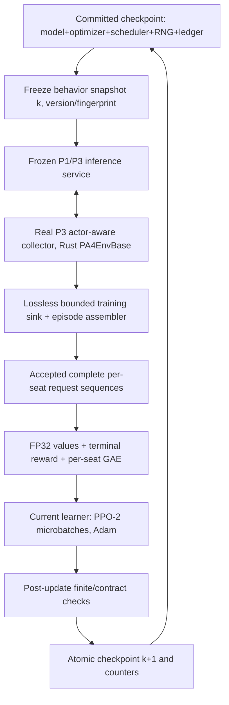

# PokeAgent 4.0 — P4 Detailed Design
## End-to-End Synchronous On-Policy PPO-2, Numerical Parity, and Checkpoint Recovery

**Document ID:** `PA4-P4-DESIGN-v1.0`  
**Prepared:** 2026-10-22 (KST)  
**Status:** DESIGN READY; P4 **not implemented**  
**Parent:** `PA4-MASTER-ARCH-v1.2` (`docs/master/PA4_MASTER_ARCHITECTURE.md`)  
**Predecessor:** P3 `PA4-P3-DESIGN-v1.0`, recorded **PASS**, with ADR-008 scoped G3-A  
**Source repository:** https://github.com/mwl313/PA4  
**Observed main HEAD at design time:** `a977a5c344f99cd08552884f19c746f13d566793`  
**P3 tested code SHA:** `13395df0e731cdc93996d63306c74703257c1dd6`  
**P3 evidence generator SHA:** `5c9096a35f9b01775a458d2ac4aea9c3ad6eedaf`  
**PA3 immutable reference:** `65bc980abd8e0bbec14158b9ddc2884bb1726a4e`  
**Environment:** WSL2 Ubuntu 24.04, RTX 4060 Ti 8 GB, Python 3.12.3, torch `2.9.1+cu128`, TorchRL `0.14.1`, TensorDict `0.14.3`, Rust `1.90.0`  
**Frozen `uv.lock` SHA256:** `8f414f526aad676f6466099da9bf96240f739abae9b9376a5c32fe845340d96e`  
**Implementation:** OpenCode `pa4-lead` (DeepSeek, sole writable agent), fresh read-only `pa4-auditor` (also DeepSeek)

> **One objective:** Close the synchronous, genuinely on-policy training loop: a frozen behavior policy plays real Rust battles, the collector delivers **all accepted records of the eligible naturally completed episodes without loss**, PA4 reconstructs correct per-seat reward/GAE and recomputes conditional joint logprobs with gradient, executes exactly specified PPO-2 optimizer updates, and durably checkpoints/restores the complete training state. All G4 results must be measured, not inferred. P4 is a correctness and recovery gate, **not** the 1,000 matches/s optimization phase.

---

## 0. Authority and evidence boundaries

### 0.1 Documents and precedence

Read these actual files in the PA4 repository before coding:

1. `docs/master/PA4_MASTER_ARCHITECTURE.md`, P4 and training-trajectory sections.
2. `docs/phases/P3/{FINAL_REPORT.md,RECEIPT.json,TENSORDICT_TRANSITION_V1.md,ADR_008.md,PERFORMANCE_BASELINE.csv}`.
3. `docs/phases/P2/{TENSORDICT_SPEC.md,FINAL_REPORT.md,RECEIPT.json}`.
4. `docs/phases/P1/{ACTION_DISTRIBUTION_DESIGN.md,FINAL_REPORT.md,RECEIPT.json}`.
5. `docs/phases/P0/SOURCE_FREEZE.md`, `docs/DECISIONS.md`, and `AGENTS.md`.
6. Read-only PA3 reference at the pinned SHA: `agent/ppo/{config.py,gae.py,losses.py,learner.py,schedule.py}`, `agent/model/{pa3_model.py,scorer.py,precision.py}`, `agent/buffer/rollout_buffer.py`.

**Precedence:** the frozen engine's rules, observation and action contracts are immutable. The Master owns overall goals. This P4 design owns P4 implementation scope and acceptance gates. The explicitly user-approved `ADR-008` **remains binding**: the stock TorchRL `AsyncBatchedCollector` is not required as the outer loop. Do not silently undo that decision. Actual code/receipts govern claims about what was implemented; documents are not substitutes for working tests.

### 0.2 Verified inherited facts

| Item | P3 measured/implemented evidence | P4 consequence |
|---|---|---|
| Phase result | P3 `PASS`; 68 collector + 51 environment + 39 action tests = **158 tests**; G3-A scoped under ADR-008 | Rerun all regression suites and retain ADR-008 |
| Real execution | Rust-backed `PA4EnvBase`, `run_batched`, staged B-path `ENCODE/STEP/RESET`, GPU `InferenceServer` | Extend the known-good path, never recreate a second battle or legality engine |
| Central vs local inference | Central 2 workers: **1.24** wall matches/s; per-driver: **5.70**. Central 4: **1.05**; per-driver: **7.19** | **Do not require central topology** for learner correctness; both are valid measured P3 modes |
| GPU | RTX 4060 Ti, 8 GB; actual CUDA model-forward batching demonstrated | P4 must also fit gradients, Adam states and activations; start with sequential actor then learner GPU residency |
| Transitions | `PA4ActorTransitionV1`: pre-action 9-leaf observation by value, branch table/masks/refs, FP32 old logprobs, request/match identity, native result | Sufficient basis for behavior replay **if every required record is retained and matched to its true episode** |
| **Lossy P3 buffer** | `BoundedTransitionStore(capacity=256)` **drops oldest entries**; P3 16-env baseline reports 752 dropped of 1,008 stored events | **P4 cannot train from that lossy tail**. Must add a separate **lossless bounded ingestion/backpressure path** first |
| P1/P3 policy | PA3 `PA3Model`, 9,889,755 parameters, random seed `20261006`, weight fingerprint `356710...` | Keep the same architecture and initially use a matching frozen snapshot; no strength claim |
| P3 no learner | `accepted_training_matches_per_sec = null`; no value/GAE/PPO/checkpoints exist | Build and independently test all of them in P4 |
| PA3 precision | Probability arithmetic FP32; reference precision Mode A; prior PA3 mixed precision suffered batch-composition drift | P4 starts **entirely in FP32/eager**; AMP, BF16, FP16 and TF32 optimization are out of scope |
| P2 environment | Two-seat action barrier, Wait/Finished omission, true terminal-only rewards, partial resets | GAE uses **per-seat decision sequences**, not consecutive native environment steps |

Measured P3 performance is an actor-only baseline from seven configurations, **not** a forecast of PPO performance. Its `steady_matches_per_sec` for multi-driver runs is a mean of per-driver windows, not aggregate concurrent throughput. The true baseline comparison uses aggregate matches / total wall time.

### 0.3 Explicit source limitations

- P3's transition `next_observation` can contain **stale leaves** when `observation_valid=False`; these are **not** genuine observations for value bootstrap.
- P3 records the nine fixed observation leaves. Verify whether the PA3 reference model's optional **ragged effect payloads** participate in its original forward contract. Never silently claim full production-PA3 feature equivalence if fields are unavailable. P4 must reproduce the **actual P3 behavior policy input contract** exactly and separately document any gap from full PA3 inputs; if a required policy-input field cannot be reconstructed for scoring or gradients, treat G4-B as BLOCKED or obtain an ADR.
- The P2 independent oracle shares the PA4 decoder; engine trace parity does not prove independently correct observation decoding.
- Existing P1 replay delta 0.0 is self-consistency of recorded selections; it is **not** an independent numeric PPO gradient reference.
- P3's maximum observed legal candidate count 18 is a sample observation, **not** a global capacity proof. Preserve hard overflow at 64, no truncation.
- P3 performs partial worker collection and rolling reset. A fixed target count can stop with **incomplete matches**. A training iteration may not silently treat these as completed terminal episodes.

---

## 1. Objective, scope and exit definition

### 1.1 Required outcomes

1. Fully materialize one or more **closed, complete natural-match on-policy cohorts** from P3 while rejecting drops, stale versions, incomplete trajectories, duplicate matches and silent revisions.
2. Reconstruct the *two seat trajectories* using recorded pre-action policy observations, preserving actor/value mask distinctions and proper terminal +1/-1/0 reward.
3. Re-evaluate a saved action under the **same frozen behavior weights** to prove `old_logprob` parity; then re-evaluate its exact saved branch candidates under **current learner weights**, preserving gradients without resampling.
4. Compute per-seat GAE with `gamma=1.0` and `lambda=0.95`, normalize advantages over the complete iteration's valid actor rows, and run two PPO epochs with a numerically verified loss.
5. Perform CUDA forward, backward, finite gradients, gradient clipping and real Adam updates on the actual 9,889,755-parameter model within an 8 GB development budget.
6. Perform at least **20 consecutive small synchronous training iterations** with real natural matches, true optimizer steps and reported healthy statistics; do not use mock battles to satisfy this requirement.
7. Save and restore full versioned checkpoints including policy, Adam, scheduler, RNG, optimizer-step and committed-match counters; demonstrate uninterrupted vs interrupted/resumed agreement at an iteration boundary.
8. Produce a **full-stack wall-clock baseline** and gate receipts. This is not a production-scale throughput or learned-strength claim.

### 1.2 Not in P4

- No `AsyncBatchedCollector` migration, no TorchRL source patch, no Rust game-rule rewrite.
- No async overlap, stale PPO trajectories, off-policy corrections, V-trace, historical opponents or evaluation league (P5/P6).
- No Runpod, paid cloud instance, final GPU selection, Docker/cloud compatibility exercise (C1 follows G4, after separate authorization).
- No CUDA Graphs, `torch.compile`, JAX, AMP, BF16/FP16/TF32 sweeps, DDP, multi-GPU or policy downsizing (P7).
- No dashboard, public telemetry, leaderboard, human-play interface (P9).
- No training to convergence, 100M-match run, or asserted policy-strength improvement.
- No permanent battle replay database; **a small bounded per-iteration staging artifact for recovery is allowed**, but long-lived action trace retention is not required.

**Stop rule:** do not implement future phases to obtain G4. If the required actor/learner contract cannot be satisfied without architecture changes, report BLOCKED and propose an ADR.

---

## 2. Architecture and execution mode



### 2.1 Mandatory first implementation: **strictly synchronous**, frozen policy

**Iteration k:**

1. Load/retain last committed policy `theta_k` and its SHA256 weight fingerprint. Start an **identical immutable copy** for all behavior inference. Record `behavior_policy_version=k`.
2. Collect natural battles with P3 over real Rust workers. **No learner writes** until cohort is closed, drained, complete and validated.
3. Drain transition chunks without any drop; attach termination events to the correct episode/seat sequences. Reject stale, incomplete or corrupted cohorts. Exactly one natural match id per accepted episode.
4. Stop/shutdown the actor's CUDA service and release its GPU memory. A single GPU running the actor and learner concurrently is **not** required for P4; never compare two resident instances by guessing available VRAM.
5. Construct per-seat training rows and evaluate `V_old` under the frozen snapshot. Compute terminal-only GAE and normalized advantages once.
6. Initialize learner from exactly `theta_k` (or the matching persistent learner state), replay old logprobs under frozen behavior weights, then run **two PPO epochs**, with gradient accumulation and Adam. No additional environment steps during these two epochs.
7. Validate updated weights, counters and hashes; create the atomic checkpoint for k+1. Only now advance the durable `committed_training_matches` clock and make `theta_(k+1)` visible for the next iteration.
8. Begin the next cohort with `theta_(k+1)`; never use rows from a different weight version or mix behavior versions inside an on-policy iteration.

**Alternative topology:** one actor process with one local `ProcessSlotTransport` service is the first correctness profile. The tested per-driver configuration may be used for small multiprocess verification. The central distributed service is **not** a required runtime topology, since P3 measured a large slowdown on this host. Any performance selection must keep the same frozen weights and data contracts.

### 2.2 Policy and observation identities

- `model_arch`: frozen PA3 model with exactly **9,889,755 trainable parameters** (validate, do not hardcode a substitute).
- `old_policy`: the full `state_dict` of `theta_k` and the exact P3 served-model fingerprint, not merely the optimizer's newest weights.
- `learner_policy`: `theta_k` at the start of an update, `theta_(k+1)` afterward.
- `observation_contract`: source schema 2, 96 tokens, fixed payload 41,986 bytes, hash `dd723dc687a60b0568302fa0b09cfb110cbe67eac2c7022f2b4ffe4dff373e35`.
- `action_contract`: P3 staged prefix, max 4 branches, capacity 64, native ordered action tuple6, per-branch mask and token refs.
- `run/worker/slot/generation/episode/request` identities are bound to each accepted record. `policy_version`, SHA256 fingerprint and precision profile are compared against the **frozen cohort**. An identity mismatch is an error, not a reason to drop that row while continuing the update.

---

## 3. P4-A — Lossless actor-to-training handoff (highest-priority blocker)

### 3.1 Why P3's bounded deque is insufficient

`pa4/collector/transitions.py::BoundedTransitionStore.put()` currently evicts the oldest record upon capacity overflow. In P3 this was intentional: it measured throughput without a learner. For PPO, an early deleted request may contain the only evidence of a seat's action/value before its eventual terminal reward. **It cannot be reconstructed from a final summary.**

Therefore:

- P4 **must not** train directly on a `BoundedTransitionStore` report when `dropped > 0` or when only the last `capacity` transitions were retained.
- Add an opt-in **lossless synchronous sink** to the existing P3 acting loop, or a narrowly factored callback that passes every accepted `PA4ActorTransitionV1` to a bounded consumer with **blocking backpressure** and explicit acknowledgment.
- The P3 benchmark mode and default lossy ring behavior may remain untouched for reproducibility; P4 training mode must use the lossless path.
- Boundedness remains mandatory: a budgeted CPU episode store or bounded temporary iteration spool is permitted. Overflow pauses collection or **fails the iteration**; it never silently evicts a record or continues with an incomplete batch.
- A training round must record `produced`, `delivered`, `acknowledged`, `duplicate`, `revised`, `dropped`, `incomplete` and `accepted_for_training`. A successful G4-A has **`dropped = 0`**, `produced == acknowledged` (for accepted emitted transitions), and all accepted matches trace back to complete seat sequences.

### 3.2 Episode assembler: **match** and **side** are different units

Canonical episode key, available **before** terminal commit:

`(run_id, worker_id, native_slot, native_generation, episode_id)`.

Terminal `match_id` may be absent on intermediate transitions. Attach an eventual terminal `match_id` to the entire previously accumulated episode by matching the five-field key. **Never** group all rows with null `match_id` together.

For each episode, construct **two ordered seat sequences**:

`(episode_key, seat=0)`, `(episode_key, seat=1)`.

Only **accepted** requests of request kind Preview/Normal/Replacement create behavior/value rows. No rows for Wait/Finished. A seat's next learning row is its **next actual policy decision**, which may happen several Rust advances later; it is not simply the next `EnvBase.step()`.

- Ordering: `step_index`, then per-seat `request_id` as necessary; assert strictly monotone request identity within an episode and no duplicates.
- `actor_active=True` iff **any real branch K>=2**; such rows contribute policy loss + entropy/KL, as well as value loss.
- A fully deterministic but valid requesting row (`K=1` for every branch) contributes **value loss** and temporal credit assignment but **not** actor loss. Wait/Finished contribute neither.
- Each unique accepted natural match increments the training match count **once**, even when both seats produce many rows.
- In current-vs-current symmetric self-play, both seats' request rows are eligible for training. Each side has its own reward and GAE; the opponent's reward may never be inserted into the other side's value chain.
- Terminal reward must be attached to the **last accepted decision in each side's sequence**, whether or not that side actually acted in the terminal Rust step. The original P3 per-native-step `reward[2]` is match-level; do not rely on a terminal `seat_record` existing for both seats on the last transition.
- For a natural winner: seat0 `+1` / seat1 `-1`, or reverse; draw zero/zero. Intermediate decision rewards zero. Terminal `done=True` is set on the final **decision row** of *each* side's trajectory.
- **Reject or defer** truncated, operationally failed, aborted, incomplete or partly dropped episodes. They are not completed natural training matches; do not fabricate a `done`, loss or winner. If P4 chooses to preserve unfinished episodes between cohorts, it must preserve exact env/actor state and still not mix policy versions; **simplest P4 path is drain all in-flight matches with the same frozen policy, or discard unfinished episodes explicitly and account for them.**

### 3.3 Observation and candidate fidelity

Per seat row persist in an iteration-local immutable structure:

- exact nine pre-action observation leaves, with dtype/shape and visibility/knownness masks;
- `request_kind`, `request_id`, full episode key, seat, pre-action step index;
- each branch's **ordered native tuple6** candidates, padded legal mask of width 64, entity/move token refs, selected index, `branch_k`, FP32 branch logprob;
- `joint_logprob_fp32`, `actor_active`, original frozen policy version/fingerprint/precision contract;
- `V_old` (computed from same frozen weights in P4 before mutation), side terminal reward and done, advantage and return;
- row/episode validity and unique provenance digest.

**Never** rebuild old legal candidates from a later native handle, regenerate the random choice or treat opponent unknown values as known zeros. Candidate-width padding may be compacted only after checking that no legal, selected or stored candidate is lost.

### 3.4 Specific risk: `next_observation`

The P3 transition contract explicitly says invalid per-seat next views can be **stale**. At P4 only an `observation_valid=True` view at that seat's **next real request** may be used to compute a bootstrap value. For P4's **completed-only** initial path, each trajectory ends at a natural terminal and uses terminal bootstrap `0`; do not use stale next-observation leaves at all to build return targets.

### 3.5 Negative tests (minimum)

- Capacity 2 sink, producer 3 transitions, delayed consumer: assert **pause/backpressure or fail-closed**, never drop-and-continue.
- Missing first decision, swapped seat, duplicate request, cross-generation row, malformed mask, mismatched fingerprint, revised decision, terminal without earlier seat rows: **reject cohort**.
- Naturally completed `(Replacement,Wait)` and `(Wait,Replacement)` games: both seats get their true last-request terminal reward, with no fabricated WAIT actor row.
- Multiple episodes in the same native slot with a new generation/episode: never merge GAE chains.
- Synthetic partial/truncation and a naturally complete battle in the same batch: partial/truncated episode excluded, natural complete included once.

---

## 4. P4-B — Frozen policy, logprob parity, and value reference

### 4.1 Two deliberately distinct scoring interfaces

**A. Verify behavior (`theta_k`):** use the exact frozen weights and observation/candidates from the actual P3 record. Recalculate each branch and request logprob in FP32. Check its stored observation and candidate digests, policy version, weight fingerprint, selection legality and ordered prefix. Require `max_abs_branch_delta <= 1e-5` and `max_abs_joint_delta <= 1e-5` on the fixed FP32 path, or record a reproducible blocker if the pinned reference cannot meet its existing P1 threshold. No silent tolerance widening.

**B. Recompute learner (`theta`):** score **the same saved indices, masks, token refs and observation** using the current trainable model, preserving gradients. Do **not** enforce `theta`'s *current* weight fingerprint equals the old behavior fingerprint after an update; the learner is **supposed** to change. Verify the old behavior identity on admission, not by forbidding updated-weight evaluation. No resampling and no regenerated native candidates during updates.

At the beginning of an epoch, before any optimizer update, `ratio = exp(new_lp - old_lp)` should be 1 within the documented numeric tolerance for valid actor rows when weights and precision match. After optimizer steps, movement is expected; do not add an always-one check that would make PPO invalid.

### 4.2 Critic and value inputs

Use the same PA3 `PA3Model` encoder and **observation-only critic** from the current frozen behavior snapshot to compute `V_old(s_t)` once, before gradient updates. The critic must not see the selected action prefix, hidden truth from the opponent or the post-terminal winner when producing a pre-action value.

**Potentially missing ragged inputs are an explicit audit condition**, not permission to synthesize data. Confirm actor inference and learner recomputation consume the same fully typed policy input; inspect the real P3 `batched_scorer` and PA3 observation conversion. If a missing ragged field makes the P3-recorded observation materially non-equivalent to the referenced policy forward, fail G4-B until the contract is resolved with actual evidence.

### 4.3 Independent numerical reference

Implement a small deterministic PA3-linked **golden parity harness**, separate from the P4 loss implementation, with identical frozen weights and candidate/observation fixtures:

- PA3 reference conditional scorer and learner-side evaluation, including hidden prefix carry;
- closed-form GAE on 2–4 element hand-calculated seat sequences;
- clipped surrogate, half-MSE critic, normalized entropy, reverse uniform KL, approx KL and gradient, with independently constructed FP32 tensors;
- at least one **real engine-derived trajectory**, not just manufactured scalar examples;
- policy/value gradients compared parameter-wise or using stable grouped norms + documented per-tensor deltas.

A test that calls the same P4 function twice is **not** independent parity evidence. PA3's own reference functions can be used as one oracle, but also retain a simple separately coded scalar/tensor formula or a frozen expected-result fixture to catch shared implementation mistakes.

### 4.4 Precision and tolerance

- Mode A / FP32 reference first. Disable autocast, GradScaler, TF32 and any experimental precision conversions in P4 initial acceptance profile.
- Fix immutable deterministic seeds and pinned batch composition for golden comparisons.
- Probability normalization/legal mask: sum over real candidates = 1 within `1e-6`; illegal/padded probability exactly zero; no NaN/Inf.
- Old logprob: `<= 1e-5` absolute per valid branch and joint as above.
- Loss scalar and gradients: require close agreement with the independent FP32 reference under a **predeclared** fixed `atol=1e-5, rtol=1e-4` where appropriate. Record max absolute/relative error and exact tested device; a CPU strict comparison may be tighter. Any change of tolerance requires an ADR and must never be silently tuned to PASS.
- Finite value/advantage/ratio/gradient required; an anomaly or recompute drift fails closed, with no persisted optimizer update.

---

## 5. P4-C — GAE, PPO-2 and optimizer

### 5.1 GAE is **per player request sequence**, not native-step based

Let `t=0..T-1` enumerate a **single side's accepted decision rows** in one completed natural match. Every intermediate decision reward is zero, and the last decision has the native terminal result `+1/-1/0`. Set `done[T-1]=True` and final bootstrap to zero.

\[
\delta_t = r_t + \gamma (1-d_t)V_{t+1}^{\mathrm{old}} - V_t^{\mathrm{old}}
\]
\[
A_t = \delta_t + \gamma\lambda(1-d_t) A_{t+1},\qquad R_t = A_t + V_t^{\mathrm{old}}
\]

`gamma=1.0`, `lambda=0.95`. Never link the two seats' GAE, include Wait/Finished as artificial timesteps, pay a reward twice or bootstrap from a `next_observation` whose `observation_valid` is false.

Normalize `A_t` **once across this iteration's valid actor rows only**: population std (`unbiased=False`), floor `1e-8`, matching PA3 `normalize_advantages`. The value targets `R_t` remain unnormalized. Singleton value rows receive true GAE/returns but no actor/regularization loss.

### 5.2 Exact PPO objective

For actor rows:

\[
\ell_t^{\pi} = -\min\left(\rho_t A_t,\, \operatorname{clip}(\rho_t,1-\epsilon,1+\epsilon)A_t\right),\quad
\rho_t = \exp(\log \pi_{\theta}(a_t|s_t) - \log \pi_{\mathrm{old}}(a_t|s_t))
\]

where `log pi` is the **joint** sum of all valid conditional branch logprobs; `epsilon=0.2`. Compute log-ratios and reductions in FP32; any numerical clamp used for safety must match the reference loss path and be documented.

Critic for all valid requesting rows, including singleton rows:

\[
L_V = \frac{1}{2}\operatorname{MSE}(V_{\theta}(s_t),R_t)
\]

No value clipping. Aggregate policy/entropy/regularization over actor rows, value loss over all valid value rows, each with its own **true denominator**. For per-request regularizers use PA3's normalized per-branch entropy and `KL(U||pi)` as defined in `agent/model/pa3_model.py`; singleton branches contribute zero to regularizer. The total objective is:

\[
L = L_{\pi} + 0.5 L_V - 0.01 H_{\mathrm{normalized}} + 0.001\, KL_{\mathrm{normalized}}(U\|\pi).
\]

Reference `approx_kl = mean((ratio - 1) - log(ratio))` over valid actor rows, and clip fraction uses `abs(ratio-1)>0.2`. Epoch KL response: if **epoch-level** approximate KL exceeds `0.03`, stop the **remaining epochs for that iteration only**, commit the valid already-performed updates if finite, and start a newly frozen rollout next iteration. If it exceeds at epoch 1, `epochs_run=1` is a valid **early-stopped PPO-2** result, not evidence of an unexecuted second epoch.

### 5.3 Optimize for correctness first

- Adam: `betas=(0.9,0.999)`, `eps=1e-5`, weight_decay `0`; gradient max-norm `0.5` (the PA3 reference contract).
- Exactly **2 PPO epochs scheduled**, not the four-epoch default of `agent/ppo/config.py`. P4 profile must explicitly override and assert `ppo_epochs=2`.
- Initial LR schedule: `1e-5` warmup start, peak `3e-4` at 250,000 committed training matches, cosine toward `3e-5` by 100M. P4's tiny smoke only covers the early warmup region. Scheduler clock advances by **successfully committed unique accepted natural training matches**, never by decision rows, both seats, PPO epoch count or wall time.
- Use fixed-shape padded minibatches with explicit `row_valid` mask; padding has zero policy and critic weight. A trailing partial minibatch is **not silently dropped**.
- Preserve one **true effective minibatch objective** under microbatch gradient accumulation. If a minibatch has differing actor and value row counts among micros, scale each term by its own valid-row share of the full minibatch (see PA3 `agent/ppo/learner.py::_process_minibatch` `exact_row_weighted_accumulation`). A naive equal microbatch average is forbidden.
- Empty-actor minibatch: skip policy/entropy/KL denominator contribution safely; if valid value rows exist, critic still updates. An all-invalid minibatch must not create an optimizer step or NaN.
- One GPU, eager execution, FP32, no DDP. A run's `optimizer_steps` counter only increments for real successful Adam steps, never on gradient clipping alone or skipped invalid batches.

### 5.4 P4 dev-8GB config: **proposals to validate, not pinned measured throughput**

```yaml
schema_version: pa4.p4_training.v1
profile: p4_dev_8gb_correctness
host: windows11_wsl2_ubuntu2404
gpu: rtx_4060_ti_8gb
precision: fp32_reference
model: pa3_reference_9889755
collector: p3_actor_aware_ADR_008
run_mode: strictly_synchronous
behavior_policy: frozen_current_v_k
opponent_policy: same_frozen_v_k
worker_count: 1
num_envs: 4
natural_completed_matches_per_iteration: 16
collector_transition_delivery: lossless_backpressure
allow_transition_drops: false
complete_episodes_only: true
actor_learner_gpu_overlap: false
ppo_epochs: 2
effective_minibatch_rows: 64
microbatch_rows: 8
clip_epsilon: 0.2
gamma: 1.0
gae_lambda: 0.95
value_coefficient: 0.5
value_clip: false
entropy_coefficient: 0.01
uniform_kl_coefficient: 0.001
target_approx_kl: 0.03
max_grad_norm: 0.5
optimizer: adam
adam_betas: [0.9, 0.999]
adam_eps: 1.0e-5
weight_decay: 0.0
lr_start: 1.0e-5
lr_peak: 3.0e-4
warmup_matches: 250000
horizon_matches: 100000000
lr_final: 3.0e-5
smoke_iterations: 20
cuda_graphs: false
compile: false
amp: false
tf32: false
seed: 20261006
```

These values are a **small initial trial**. Change only hardware-sized controls (`num_envs`, `effective_minibatch_rows`, `microbatch_rows`, memory allowance) to fit CUDA memory, and report measured sizes; do not change probability/legality/GAE/loss semantics to work around OOM. If P4 fails due to GPU memory, try fewer envs or microbatch `4`/`2`, then CPU reference smoke as a diagnostic; **CUDA G4-C cannot PASS from CPU fallback alone**. P4 must preserve gradients for the same model under the actual frozen contract.

**Important:** `16` natural matches per iteration with `4` envs is an intentionally small development sample, not a statistically useful policy-improvement experiment. Count the actual accepted rows and optimize only after correctness.

### 5.5 TorchRL usage

TorchRL/TensorDict are the runtime interchange and useful library utilities, **not** a requirement to force `ClipPPOLoss` on a bespoke conditional distribution that it cannot represent exactly. In P4:

- Reuse `TensorDict` and frozen existing TorchRL/TensorDict versions.
- The preferred path is the **minimal custom PPO loss** mirroring PA3's verified conditional action contract, with a separate golden oracle.
- `torchrl.objectives.ClipPPOLoss` or `torchrl.objectives.value.GAE` may only replace custom arithmetic **after actual signature inspection and numerical/gradient parity on the frozen stack**. They are **optional**, never mandatory P4 dependencies.
- Do not introduce a second unrelated policy representation or an off-policy replay buffer merely to fit an API.

---

## 6. P4-D — Atomic checkpoint and crash-safe resume

### 6.1 Checkpoint state, mandatory fields

Use a schema-tagged `PA4CheckpointV1`, at **iteration boundaries**, containing:

| Field | Requirement |
|---|---|
| Provenance | `checkpoint_schema`, run/config/source SHA, PA3 SHA, lock SHA256, observation/action contract hash, architecture signature |
| Model | complete trainable model `state_dict`; exact fingerprint; policy version |
| Optimizer | Adam state, per-parameter moments, `optimizer_steps` |
| LR scheduler | scheduler configuration, `committed_training_matches`, current LR, warmup/cosine position |
| RNG | Python `random`, NumPy if used, `torch` CPU, `torch.cuda` RNG state(s); deterministic sample ordering/seed inputs |
| Policy state | last frozen behavior version and updated candidate new version, where appropriate; precision profile |
| Ledger | committed natural match count, last successfully committed iteration, unique match identities needed to reject replay on this run, accepted row counts |
| Safety counters | nonfinite/failed updates, discarded incomplete matches, rejected revisions, delivery drops, policy-lag=0 |
| Runtime metadata | hostname/platform, measured CUDA device, critical package versions, checkpoint file checksum |

A fully serializable **optimizer + scheduler + RNG** state is essential. Saving `model.state_dict()` alone is **not** a successful P4 recovery checkpoint. Do not use an untrusted external pickle artifact for restore.

### 6.2 Transaction ordering and atomicity

- At each iteration start, identify the last **durably committed** checkpoint (`k`). The frozen policy snapshot for collection is derived only from that checkpoint.
- Collect and validate an immutable batch for iteration `k+1`; if the collector fails or partial episode evidence is missing, no optimizer state or committed counter is advanced.
- Execute update in memory. Compute candidate next counters and matching hashes.
- Serialize checkpoint to a **temporary file in the same filesystem**, flush/fsync, compute SHA256, atomically rename to its final versioned path; then atomically update a small manifest/pointer to designate the new checkpoint as committed. Keep the previous good checkpoint.
- If a process dies **before** the commit pointer changes, resume from prior `k` and do not claim any partial updates or newly sampled matches were durably accepted. The new uncommitted data is either safely recoverable from an iteration-local spool with verified identity/version or explicitly discarded and recollected under the previous version.
- If death occurs **after** commit, resume from `k+1`, without reapplying the same optimizer step or double-counting the accepted match set. Never infer committed state from a half-written file.
- Release/recreate P3 inference clients at a **fresh policy version**; no stale cache entry may span a policy replacement. Exact same-model replay at iteration start is checked before new generation.

### 6.3 Resume test (must execute, not just describe)

Run two identical short fixed-seed controlled paths:

1. **Continuous**: e.g. four training iterations with fixed collected cohorts and deterministic training order.
2. **Interrupted**: save at boundary after iteration 2, terminate/exit, relaunch a new process, load checkpoint, finish iterations 3–4 using the same **pre-recorded, verified on-policy cohorts** or deterministically regenerated equivalent evidence.

Compare final model weights (per tensor), optimizer state tensors, scheduler, match counters, policy-version/fingerprint evolution, RNG state and optimizer-step counts. The CPU tiny deterministic reference should be exact where feasible. CUDA numeric comparisons use a **predeclared tolerance** (`atol=1e-5, rtol=1e-4` for FP32 where applicable), with measured deltas and an explanation if exact bitwise equality is not achievable. Never call a mismatched run identical. Add corruption and interrupted-write negative controls.

**Special constraint:** identical cohorts must be valid for their respective frozen behavior weights in **both** branches. Do not replay old iteration-k actions with a different policy's old-logprob and still label the run on-policy. If using recorded inputs to isolate the resume test, record and verify each cohort's matching frozen-policy version and fingerprint.

---

## 7. P4-E — Minimal realistic full-stack trial and performance

### 7.1 Required local trial

- Complete **20 consecutive synchronous iterations**, default 16 natural matches per iteration (proposed), on WSL2 RTX 4060 Ti 8 GB; if profile sizes change, show the reason and actual values.
- Both seats run the same iteration's frozen policy. A real P3 actor and real P2 Rust environment produce the decisions and native terminal wins/losses.
- No replay record drop; no weight-policy mismatch; no fabricated completion; no illegal native action; no nonfinite loss/gradient; no stale server cache across updates; no duplicated match clock.
- Assert **at least one real optimizer update per iteration** with actual parameter change, unless a documented KL early-stop path legitimately finishes after at least one update. Explicitly compare pre/post fingerprints and parameter/optimizer counters.
- Record for each iteration: behavior version, model/fingerprint, `generated_natural_matches`, `accepted_training_matches`, `discarded_incomplete`, `decision_rows`, `actor_active_rows`, `value_rows`, `ppo_epochs_run`, `optimizer_steps`, LR, total/update loss components, approx KL, ratio mean, clip fraction, entropy, reverse KL, gradient norm, maximum VRAM allocated, stage times and wall seconds.
- Keep a small trainability sanity signal (e.g. nonzero gradients, changed parameters); **do not claim skill improvement or convergence** from this smoke.

### 7.2 Throughput denominator must be honest

For the complete synchronous training interval measured from start of collection to durability of the matching checkpoint:

`raw_completed_matches_per_sec = natural_native_completed / total_wall_seconds`

`accepted_training_matches_per_sec = distinct_natural_matches_admitted_into_successfully_committed_PPO_iterations / total_wall_seconds`

`policy_rows_per_sec = eligible_accepted_per-seat_policy_rows / total_wall_seconds`

`learner_row_passes_per_sec = actual_valid_rows_consumed_over_all_epochs / total_wall_seconds`

`optimizer_steps_per_sec = successful_optimizer_steps / total_wall_seconds`

- Include inference process start/stop where it occurs per iteration, actor collection, lossless handoff, GAE, optimizer, checkpoint serialization and **all mandatory iteration work**.
- No row/seat double-counting as a second match. Do not count a partial episode or a permanently dropped batch as accepted training matches.
- Record raw P3 actor-only results separately as historical context, not as equal-configuration evidence for P4; model may train between P4 iterations and the timing scope is different.
- This 8GB throughput is a **development baseline**, not the Runpod GPU price/performance decision (C1/P7) nor the sustained 1,000/s target (P8).

---

## 8. Minimum implementation packages

### P4-0 — Preflight and P3 intake audit

- Verify actual Git head/worktree; P3 final report, ADR-008, P3 transitions, recent regression and frozen lock.
- Verify no unexpected source divergence from the pinned PA3 SHA and that the scratch engine still matches.
- Run and inspect a real P3 collector cohort **with the lossless sink configured**. Reject or pause any run that would silently drop old records.
- Verify missing ragged observation/features issue against the actual P3 policy input and PA3 reference and document the result; do not assume feature completeness.
- Choose and pin a stable reproducible dev-8GB profile; record exact memory budget and number of actor/learner GPU instances.

### P4-A — Accepted complete trajectory assembler

- Implement only the narrow lossless sink/callback/backpressure and per-match/seat assembler defined in §3.
- Produce a small fixed, replayable accepted-cohort artifact for golden tests, not a general historical replay service.
- Fail closed on drops, incomplete episodes, stale version/fingerprint, wrong masks, duplicate identities and missing terminal events.

### P4-B — Independent GAE / logprob / PPO numeric oracle

- Build frozen-snapshot equality test for saved old logprobs and value predictions.
- Implement request-level per-seat GAE, mask-specific advantage normalization, conditional reevaluation without resampling, and independently compared gradients/loss terms.
- Record precise source fixtures and tolerance receipts. Do not accept only self-replay.

### P4-C — End-to-end PPO-2

- Implement minimal eager FP32 Adam learner, gradient accumulation, clipping, KL early-stop and match-clock scheduler with two epochs.
- Use actual 8GB CUDA, one model architecture, real frozen actor-produced trajectories. Profile viable microbatch sizes without changing objective meaning.
- Verify before/after model fingerprints and that the new behavior service runs the **new** weights at the next iteration.

### P4-D — Checkpoint/resume

- Implement `PA4CheckpointV1`, atomic manifest/commit, RNG and optimizer state restore, deterministic controlled resume comparison, interrupted-write and corruption rejection.

### P4-E — Gate trial, audit and receipts

- Run >=20 small full-stack iterations, evaluate G4-A through G4-E, run P1/P2/P3 regressions, frozen P0 smoke, `check_env_specs`, and fresh-context read-only `pa4-auditor` review of **actual WSL repository files and executable evidence**.
- Commit tested implementation first, then receipt/report metadata. Stop after P4.

---

## 9. Five objective G4 acceptance gates

| Gate | PASS requires (all conjuncts) | Immediate BLOCKED/PARTIAL examples |
|---|---|---|
| **G4-A: Lossless valid rollouts** | Real P3 policy/Rust battles, immutable correct frozen policy identity, **0 accepted-transition drops**, complete natural match cohorts, per-seat decision sequence and exact terminal reward, no fabricated rows or double count, negative controls for overflow/identity/truncation | Training from evicting P3 ring; missing initial rows; incomplete episodes counted; last-step WAIT side never credited |
| **G4-B: Numerical golden parity** | Old FP32 branch/joint logprob <=1e-5; real PA3-derived policy/value inputs verified including feature contract; GAE and PPO scalar/mask/gradient parity against a separate reference; wrong/illegal prefix and stale policy rejected; 0 NaN/Inf | Using same function twice as oracle; hidden GRU reset; scorer ignores stored token refs; any unknown ragged field silently fabricated |
| **G4-C: Real PPO-2 updates** | Real single-GPU CUDA model, 2-epoch schedule with correct KL early-stop semantics, actor/value denominators and microbatch accumulation parity, correct Adam/LR/clipping; >=20 small synchronous real-match iterations with true optimizer steps and no invalid/stale rollouts | CPU-only training claimed as CUDA; no actual parameter update; new policy served before iteration boundary; `ppo_epochs=4` default silently used |
| **G4-D: Durable restore** | Complete model+Adam+scheduler+RNG+match ledger checkpoint; checksum/atomic pointer; controlled 4-iteration continuous-vs-resume proof; corrupt/incomplete checkpoint fails closed; no double counting or replaying stale behavior | Save model only; resume loses Adam moments; LR clock counted twice; partial file accepted |
| **G4-E: Full-stack and audit** | Reproducible end-to-end timing and metrics for the tested 8GB profile, 158 inherited P1/P2/P3 tests still green (or explain changed actual count), P0 smoke and `check_env_specs`, unchanged lock+PA3, fresh `pa4-auditor` review of real WSL repo source/evidence, no unresolved blocker | Actor-only mps presented as PPO throughput; auditor inline-only/no repo access; undocumented source or dependency drift |

**Overall `PASS` only if all five gates are proven on real code and evidence.** A runtime that produces losses but fails old-logprob parity, a trainable loop that drops accepted records, or a checkpoint that omits the optimizer is **not PASS**. Mark `PARTIAL` for separately bounded gaps and `BLOCKED` when the core numeric/on-policy contract cannot be satisfied. Never lower a gate or stretch a performance claim to get PASS.

---

## 10. Minimal test matrix (focus on falsifiable controls)

| Test group | Minimum falsifiable controls |
|---|---|
| `test_training_ingest.py` | P3 capacity overflow blocks/fails without loss; multi-episode key join; corrected terminal reward to both seats despite Wait; old/foreign fingerprints refused; padded branch masked; all accepted rows delivered |
| `test_gae.py` | hand-computed 1-row and 3-row terminal trajectories; signed reward per side; singleton critic included, no actor; unknown/stale next observation not bootstrapped; incomplete episode rejected |
| `test_logprob_parity.py` | real P3 saved action vs matching old weights; GRU prefix-sensitive negative test; candidate permutation fails; wrong policy version/fingerprint fails admission; no illegal selected index; no resampling |
| `test_ppo_loss.py` | independent PA3 loss/gradient scalar fixture; clipped positive/negative advantages; separate actor/value denominators; entropy and uniform KL nonzero gradients; minbatch=microbatch vs accumulated micros parity; padding-only and singleton-only |
| `test_optimizer_smoke.py` | actual 4060 Ti CUDA gradient, Adam state, LR match-clock; two epochs/early-stop; 20 real iterations; no parameter update from invalid cohort |
| `test_resume.py` | save/restart optimizer/scheduler/RNG and match counts, compare continuous and resumed updates, interrupted-write and damaged-blob rejection, no mid-iteration double commit |
| **Inherited regression** | `tests/action_distribution`, `tests/environment`, `tests/collector`, P0 smoke and real `check_env_specs` |

Tests should use the existing standard-library `unittest` approach unless the pinned lock already supports another runner. **Do not add dependencies** or run a massive all-team sweep just to fill a checklist. Unit tests do not replace the actual CUDA end-to-end trial.

---

## 11. Proposed file ownership and artifacts

These are **proposed paths**, not a claim they already exist.

```text
pa4/
  learner/
    __init__.py
    ingest.py                 # lossless cohort builder, episode/seat join
    gae.py                    # per-seat closed-episode GAE
    parity.py                 # old snapshot, independent reference harness
    ppo_loss.py               # conditional PPO terms / row masks
    update.py                 # eager FP32 two-epoch Adam updates
    checkpoint.py             # atomic full-state save/restore
    train_sync.py             # P3 actor -> learner -> checkpoint loop
configs/
  algorithm/p4_dev_8gb.yaml
scripts/
  p4_smoke.py                # small, bounded real training
  p4_resume_check.py
  p4_parity_check.py
tests/
  ppo/
    test_training_ingest.py
    test_gae.py
    test_logprob_parity.py
    test_ppo_loss.py
    test_optimizer_smoke.py
    test_resume.py
docs/phases/P4/
  DESIGN.md                  # verbatim copy of this design
  INPUT_CONTRACT_AUDIT.md    # lost records / observation / ragged parity decision
  TRAJECTORY_CONTRACT_V1.md
  PPO_NUMERICAL_PARITY.md
  CHECKPOINT_RECOVERY.md
  FULL_STACK_BASELINE.csv
  FINAL_REPORT.md
  RECEIPT.json
```

If some classes can be implemented more simply within fewer files without harming traceability, the lead can consolidate them. Do not add a second policy harness or speculative distributed infrastructure.

### 11.1 Evidence schema, minimum

`docs/phases/P4/RECEIPT.json` must report actual or JSON `null` values for:

```json
{
  "phase": "P4",
  "design_id": "PA4-P4-DESIGN-v1.0",
  "verdict": "NOT_RUN",
  "pa4_tested_code_sha": null,
  "pa4_final_head_sha": null,
  "pa3_reference_sha": "65bc980abd8e0bbec14158b9ddc2884bb1726a4e",
  "dependency_lock_sha256": "8f414f526aad676f6466099da9bf96240f739abae9b9376a5c32fe845340d96e",
  "gates": {
    "G4_A": "NOT_RUN",
    "G4_B": "NOT_RUN",
    "G4_C": "NOT_RUN",
    "G4_D": "NOT_RUN",
    "G4_E": "NOT_RUN"
  },
  "accepted_transition_drops": null,
  "natural_matches_generated": null,
  "natural_matches_committed_for_training": null,
  "eligible_actor_rows": null,
  "eligible_value_rows": null,
  "old_joint_logprob_max_abs_delta": null,
  "ppo_loss_golden_max_abs_delta": null,
  "ppo_gradient_golden_max_abs_delta": null,
  "iterations_completed": null,
  "optimizer_steps": null,
  "resumed_state_parity_pass": null,
  "accepted_training_matches_per_sec": null,
  "actor_only_matches_per_sec": null,
  "auditor_read_real_repo": null
}
```

This is a **schema illustration**, not test evidence. A generated report must not leave `NOT_RUN` if the phase has actually been executed. Keep real measured commands, checksums, model fingerprints, seed configs, observed errors and actual stdout summaries with the receipt.

### 11.2 Commit protocol

- Keep the P3 implementation/evidence reproducible. A training-only sink mode is preferable to overwriting the prior `BoundedTransitionStore` benchmark semantics.
- Capture the current Git HEAD and user changes before editing. Do not overwrite user work.
- Commit tested implementation and tests first; record the exact tested SHA in the receipt. Commit docs/receipt separately. Report final HEAD and clean/dirty status honestly, without a self-referential SHA field.
- No push to GitHub without explicit authorization; no keys or local cloud credentials in Git.
- Never modify the pinned PA3 source, production checkpoints or active training processes.

---

## 12. Risk register, resolution conditions and P5/C1 handoff

| Risk | Severity | Required mitigation / future owner |
|---|---|---|
| **P3 lossy ring deletes early decisions** | **BLOCKER** | P4-A lossless sink + backpressure before training; reject any cohort with drops |
| **Terminal reward assigned only to acting seat on last Rust step** | **BLOCKER** | P4-A group by episode+seat and credit last **actual** decision of each side |
| **P3 nine-leaf observation differs from full PA3 ragged inputs** | **BLOCKER if needed by scorer** | P4-0 input audit, align actor/learner model inputs and independently document production-reference gap |
| **FP32 old vs current policy mismatch / GRU reset** | **BLOCKER** | P4-B old matching snapshot parity, separate current differentiable scoring, prefix-hidden golden test |
| **Microbatch gradient weighting diverges** | High | P4-C actor/value denominators and exact full-minibatch accumulation; gradient reference |
| **8GB actor + learner simultaneous OOM** | High | Sequential GPU residency, microbatch reduction; report actual peak memory |
| **Partial matches across policy boundary** | High | Finish with frozen policy, or explicitly discard incomplete episode with measured accounting; never relabel rows on-policy |
| **Native truncation/event counted as completed match** | High | P2/P3 exactly-once ledger, failure injection, accepted-match recount |
| **Checkpoint crash after optimizer step but before durable commit** | High | Atomic manifest commit, rollback to previous complete iteration, matched RNG/ledger |
| **Very low host throughput** | Medium | Do not optimize prematurely; measure end-to-end honestly; scale/transport belongs to P6/P7 |
| **Same-model DeepSeek auditing** | Medium | Fresh read-only review is only a process control; independent tests/PA3 golden oracle decide gates |

### 12.1 P4 -> C1 handoff (separate authorization)

If and only if G4 passes, deliver the smallest immutable code/config/checkpoint package needed for **C1**: Runpod Secure Cloud single-GPU CUDA compatibility smoke, native engine/PyO3 load, a couple of real current-vs-current matches, one PPO optimizer step, checkpoint restore and artifact backup/cleanup. **Do not provision or rent Runpod as part of P4.** C1 does not select the final production GPU.

### 12.2 P4 -> P5/P6/P7 handoff

- P5: policy snapshot registry and match/seat assignment + evaluation league; P4 only guarantees identical frozen current-vs-current self-play.
- P6: async policy replacement and stale-lag accounting, after the synchronous reference passes.
- P7: empirical topology choices and throughput optimization. P3 measured distributed-central service as slower than per-driver service here; P4 should hand over component timings and a validated end-to-end baseline, **not** lock the final topology.

**P4 completion does not prove a strong Pokémon-playing model or a 1,000 matches/s training system.** It proves a correct, restartable **real on-policy PPO-2 training loop** ready for controlled scale-up and subsequent quality evaluation.

---

## 13. Source links and code anchors

PA4 source (main at design time):

- P3 result: https://github.com/mwl313/PA4/blob/main/docs/phases/P3/FINAL_REPORT.md
- P3 machine receipt: https://github.com/mwl313/PA4/blob/main/docs/phases/P3/RECEIPT.json
- P3 transition schema: https://github.com/mwl313/PA4/blob/main/docs/phases/P3/TENSORDICT_TRANSITION_V1.md
- P3 bounded ring: https://github.com/mwl313/PA4/blob/main/pa4/collector/transitions.py
- P3 active actor loop: https://github.com/mwl313/PA4/blob/main/pa4/collector/run_batched.py
- P3 approved collector adaptation: https://github.com/mwl313/PA4/blob/main/docs/phases/P3/ADR_008.md
- P2 verified EnvBase contract: https://github.com/mwl313/PA4/blob/main/docs/phases/P2/TENSORDICT_SPEC.md
- PA4 master: https://github.com/mwl313/PA4/blob/main/docs/master/PA4_MASTER_ARCHITECTURE.md

Pinned PA3 source:

- https://github.com/mwl313/PokeAgent3.0/blob/65bc980abd8e0bbec14158b9ddc2884bb1726a4e/agent/ppo/gae.py
- https://github.com/mwl313/PokeAgent3.0/blob/65bc980abd8e0bbec14158b9ddc2884bb1726a4e/agent/ppo/losses.py
- https://github.com/mwl313/PokeAgent3.0/blob/65bc980abd8e0bbec14158b9ddc2884bb1726a4e/agent/ppo/learner.py
- https://github.com/mwl313/PokeAgent3.0/blob/65bc980abd8e0bbec14158b9ddc2884bb1726a4e/agent/ppo/config.py
- https://github.com/mwl313/PokeAgent3.0/blob/65bc980abd8e0bbec14158b9ddc2884bb1726a4e/agent/model/pa3_model.py

**Document control:** The Windows user-supplied design location for future OpenCode **execution prompt** use is `C:\Users\임민우\Desktop\PA4`; its WSL read path is `/mnt/c/Users/임민우/Desktop/PA4`. Actual code, tests and receipts always belong in `/home/pa4/projects/PokeAgent4.0`, with a verified copied design at `docs/phases/P4/DESIGN.md`.
